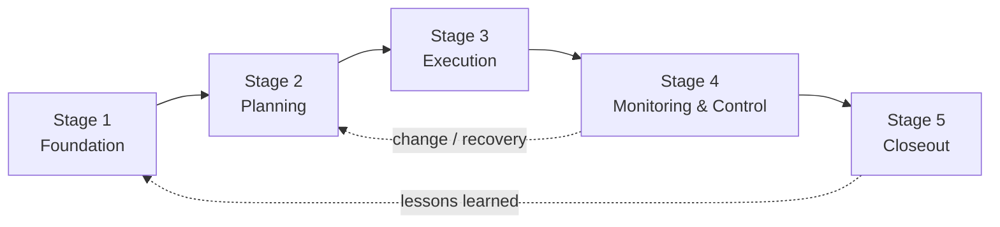
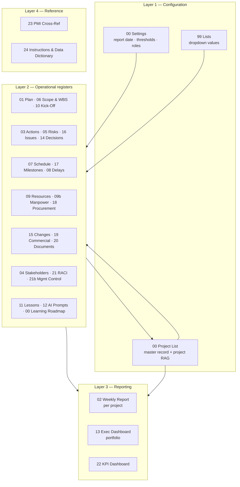
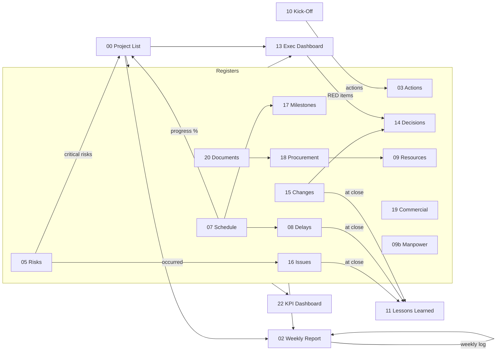

# Project Management Learning Roadmap & Project Control System

**For construction, real estate development, engineering and project-based companies in Oman and the GCC**

Companion workbook: `PM_Project_Control_Workbook.xlsx` (30 sheets, built by `build.py`).

---

## Executive summary

You learn project management here by running your own projects through it. Each of the 28 lessons ends with an exercise that puts a real entry into the workbook, so by the time someone finishes the roadmap, your company has a working project control system full of its own data. Nothing is left as theory on a shelf.

The workbook covers the 12 modules you asked for, plus the 12 control sheets that sit around them: the executive dashboard, decision log, change/variation register, issue register, milestones, procurement, commercial, document register, RACI, KPI dashboard, PMI cross-reference and instructions. Every register feeds the weekly report and the dashboards automatically. The PM writes the story; the formulas supply the numbers.

**What you can rely on**

- Every RAG status comes from a written threshold in `00 Settings`. You can see the rule, and you can change it only in one place.
- There's no invented project data. The single sample project is marked **SAMPLE DATA — REPLACE WITH ACTUAL PROJECT INFORMATION** on every row.
- The PMI references are current. As of September 2026 that means the *PMBOK® Guide – Eighth Edition* (released November 2025) and the new PMP® exam content outline (launched July 2026). The mapping between the two is my own analysis, and I've labelled it that way. PMI doesn't prescribe these templates.

---

## Assumptions

| # | Assumption | Why it matters | Change it in |
|---|---|---|---|
| 1 | Your company is usually the **contractor** delivering the works (main contractor or subcontractor), sometimes the developer. | Changes the perspective of the RACI, delay responsibility and payment tracking. | `21 RACI Matrix`, `00 Settings` roles |
| 2 | The work week runs Sunday to Thursday, and the reporting week ends on **Thursday**. | Weekly report and manpower week-ending dates. | `00 Settings` → `WeekEnding` |
| 3 | Currency is **OMR**, shown to 3 decimals. | All money columns. | Number formats |
| 4 | Contract notice period defaults to **28 days** and document review to **14 days**. | These are placeholder defaults, not legal advice. Each contract's own clauses win. | `00 Settings` |
| 5 | Planned % is **straight-line** between planned start and finish unless you enter the P6/MS Project figure. | A simplification. S-curves are more accurate. | `00 Project List` → override columns |
| 6 | RAG thresholds are **company defaults** (e.g. progress variance: GREEN ≥ −5%, RED < −10%). | They need calibrating to your risk appetite. | `00 Settings` |

---

## PMI framework used

| Source | What is used | Status |
|---|---|---|
| *PMBOK® Guide – Eighth Edition* (PMI, November 2025) | 6 principles, 7 performance domains, 5 focus areas | Verified via public summaries, September 2026 |
| PMP® Examination Content Outline (new exam, July 2026) | Domains: People 33%, Process 41%, Business Environment 26% | Verified from PMI's new-exam page, September 2026 |

- **Principles:** Adopt a Holistic View · Focus on Value · Embed Quality · Be an Accountable Leader · Integrate Sustainability · Build an Empowered Culture
- **Performance domains:** Governance · Scope · Schedule · Finance · Stakeholders · Resources · Risk
- **Focus areas:** Initiating · Planning · Executing · Monitoring and Controlling · Closing (40 processes. I haven't reproduced the individual process names because I couldn't verify them from a primary source.)

> **Important:** PMI doesn't require these templates, IDs, thresholds or RAG rules. They're company conventions built to support PMI principles. Contract notice periods, payment terms and delay entitlement come from **your contract and Omani law**, never from PMI.

---

## A. Complete course roadmap

The course has five stages and 28 lessons. At about 15 minutes of study a day plus the exercise done on a live project, a PM can complete it in roughly 10 to 12 weeks.

| Stage | Lessons | Modules / sheets used | Suggested timing | Outcome for the company |
|---|---|---|---|---|
| **1. Project Foundation** | L1.1 Charter · L1.2 Scope · L1.3 Stakeholders · L1.4 Kick-off | 1, 4, 6, 10 | Weeks 1–2 | Every live project is defined, scoped and kicked off the same way |
| **2. Project Planning** | L2.1 WBS · L2.2 Schedule · L2.3 Resources · L2.4 Risk · L2.5 Procurement · L2.6 Budget · L2.7 Integrated plan | 1, 5, 6, 7, 9, 17, 18 | Weeks 3–5 | Baselines exist for scope, time, cost, risk and resources |
| **3. Project Execution** | L3.1 Actions · L3.2 Communication · L3.3 Subcontractor coordination · L3.4 Resource monitoring · L3.5 AI tools | 3, 9, 12, 20, 21 | Weeks 6–7 | Meetings produce owned actions; the team uses AI safely |
| **4. Monitoring & Control** | L4.1 Weekly reporting · L4.2 Schedule control · L4.3 Risk monitoring · L4.4 Issues · L4.5 Commercial · L4.6 Delay analysis · L4.7 Change control | 2, 5, 7, 8, 13–17, 19, 22 | Weeks 8–10 | Weekly reports and dashboards that management trusts |
| **5. Project Closeout** | L5.1 Completion · L5.2 Outstanding actions · L5.3 Handover · L5.4 Lessons learned · L5.5 Performance review | 11, 17, 20, 22 | Weeks 11–12 | Projects close cleanly and the lessons reach the next project |



Track progress on the `00 Learning Roadmap` sheet. It shows completion % and flags overdue lessons.

---

## B. Module-by-module syllabus

### Module 1 — Project Plan (`01 Project Plan`)

**What it is.** The Project Management Plan is the single approved document that says how the project will be delivered, monitored and closed. It pulls 18 components together: objectives, business justification, deliverables, phases, scope, milestones, activities, dependencies, schedule, budget, resources, risks, stakeholders, communication, procurement, quality, monitoring and closure.

**Why you need it.** It's the baseline you measure against, the reference point for change control, and the evidence that management approved the approach. Without one, every disagreement turns into an opinion.

**Who does what.**

- **Prepares:** the Project Manager
- **Reviews:** the QS (commercial), Site Engineer (method and resources) and Procurement (long-lead items)
- **Approves:** the General Manager, or the sponsor

**When it's updated:** at award, whenever an approved change affects scope, time or cost, at re-baseline, at phase gates, and at least quarterly. Every update gets logged in the version table.

**What management should look at:**

- Are the objectives measurable?
- Is the margin still valid?
- Is contingency proportionate to the risks?
- Are the long-lead items ordered?
- Are payment milestones aligned with cash needs?
- Are the exclusions agreed with the client?

(These questions also appear in the *Management Review Focus* column.)

**Template:** 18 components, each with *what to define*, *linked sheet*, owner, status, planned and actual dates, plus a version-control table.

### Module 2 — Weekly Project Status Report (`02 Weekly Report`)

Select the project and the sheet fills in the project name, reporting week, overall and component RAG (schedule, budget, quality, HSE), planned/actual/variance %, CPI and completion forecast. It also pulls in next week's activities, critical milestones, delayed activities with delay days, root cause and recovery action, the commercial position (invoiced, certified, received, outstanding, overdue, variations, claims), manpower, equipment and material shortfalls, the top 5 risks and issues, and the decisions management needs to make.

The PM writes three things by hand: the **executive summary**, the **overall status narrative** and the list of **completed activities**.

**Executive summary formula (five lines, for the GM/CEO):**

1. Status: RAG plus one sentence
2. Key achievement this week
3. Main concern, with the numbers
4. Recovery action, with owner and date
5. Decision needed, from whom and by when

> *Example:* "AMBER — 4% behind plan. Partitions Level 1 complete. Ceiling boards arrive 6 days after the required date. Recovery: resequence Zone C, owner Site Engineer, from Sunday. Decision: approve extra crew (OMR 4,200) by Tuesday."

**The one rule that protects credibility:** the RAG must match the numbers. A GREEN report with RED figures (a "watermelon" report) destroys management's trust in the whole system.

### Module 3 — Meeting Action Tracker (`03 Meeting Actions`)

The tracker has every field you listed. Status is entered as Open, In Progress, Pending or Closed. **Current Status** is calculated, and turns to **Overdue** automatically once the target date has passed. *Days Outstanding*, *Days Overdue* and *Escalation Required* are also automatic. Escalation fires when an action is overdue by more than `EscDays` (default 7), or when a Critical action is overdue at all. Kick-off actions show up on `10 Kick-Off` automatically.

### Module 4 — Stakeholder Management (`04 Stakeholders`)

**Power/Interest method.** Score Power and Interest from 1 to 5. A score at or above `PIHigh` (default 3) counts as "high".

| | Low interest | High interest |
|---|---|---|
| **High power** | **Keep Satisfied** — consult in their area, brief them concisely, avoid surprises | **Manage Closely** — engage personally, involve them in key decisions |
| **Low power** | **Monitor** — general communication only | **Keep Informed** — regular updates; useful as an early-warning network |

Priority is the sum of Power, Interest, Influence and Impact: 16 or more is Critical, 12 or more High, 8 or more Medium. The engagement gap is the distance from current to desired engagement on the scale Unaware → Resistant → Neutral → Supportive → Leading. In Oman, remember the stakeholders who rarely appear on a client organogram: municipality and Civil Defence inspectors, the building or mall management, landlords, utility providers, neighbouring tenants and, on operator sites, the client's HSE and ICV teams.

### Module 5 — Risk Register (`05 Risk Register`)

Risk Score = Probability × Impact (each 1–5). The rating is automatic: **Low** below 5, **Medium** from 5, **High** from 10, **Critical** from 15. You can change the bands in `00 Settings`. Residual score and rating are calculated the same way. Risks not reviewed within `RiskReviewDays` (30) get flagged.

| Term | Meaning | Example | Where it lives |
|---|---|---|---|
| **Risk** | An uncertain future event that would affect objectives if it happened | Imported boards *may* arrive late | Risk Register |
| **Issue** | Something that has already happened and is affecting the project now | Boards *have* arrived late | Issue Register |
| **Assumption** | Something believed true for planning, not yet proven | Client will give access to Level 2 by 1 March | Scope statement; becomes a risk if doubtful |
| **Constraint** | A fixed limit you must work within | Night work only; handover date fixed; budget cap | Scope statement |

### Module 6 — Scope Management (`06 Scope & WBS`)

The scope statement covers 15 elements, from purpose through to approvals required. Below it sits the WBS (work package ID, owner, dates, deliverable, acceptance criteria, status). Duplicate WBS IDs are highlighted.

**How to control scope creep:**

1. Get the scope statement **and its exclusions** approved before work starts.
2. No instruction, no change. Every request goes into `15 Change Register`, even small or "free" ones.
3. Price the time and cost impact before doing the work. If work has to start before approval, record the GM's decision in `14 Decision Log`. The *Work Proceeded Before Approval* flag keeps it visible.
4. Confirm verbal instructions in writing within an agreed time.
5. Review pending changes weekly. Ageing turns AMBER at 30 days and RED at 60.
6. After approval, update the scope, schedule, budget and plan version.

### Module 7 — Project Schedule Summary (`07 Schedule`)

The schedule register has every field you listed, plus a forecast finish and an optional weight. The formulas work out duration, baseline progress % at the report date, variance, delay days, an **OVERDUE / LATE START** flag and a status (Completed, Overdue, Late Start, Not Started, Behind Schedule, In Progress).

| Term | Plain meaning |
|---|---|
| **Baseline** | The approved plan dates, frozen. You measure against them and never overwrite them. |
| **Critical path** | The longest chain of dependent activities. Any delay on it delays completion. |
| **Float** | How far an activity can slip without delaying completion (total float) or the next activity (free float). |
| **Milestone** | A zero-duration event marking a key achievement: contractual, payment, authority approval or handover. |
| **Dependency** | A logic link. FS = finish-to-start (the most common), SS = start-to-start, FF = finish-to-finish, SF = start-to-finish. |
| **Schedule variance** | Here, the progress version: actual % − planned %. Negative means behind. (The earned-value version is EV − PV.) |
| **Look-ahead schedule** | A 2–3 week detailed extract used to coordinate site work and subcontractors. |
| **Recovery schedule** | A revised plan showing how lost time will be recovered, with resources, cost and approval. |

### Module 8 — Delay Analysis (`08 Delay Register`)

The delay register uses 10 categories: client, contractor, consultant, authority, supplier, design, material, manpower, weather/external and unforeseen conditions. Contractual responsibility is chosen from a list: Employer/Client Risk, Contractor Risk, Shared/Concurrent, Neutral Event or **Under Assessment**.

**How to document delays objectively, without pinning blame you can't support:**

1. **Facts first.** Record what happened, on what date, and the document reference (letter, transmittal, minutes, site diary, photo).
2. **Separate the cause from the responsibility.** Record the category (what kind of delay) straight away. Leave *contractual responsibility* as "Under Assessment" until the QS or contracts lead has checked the clause.
3. **Record your own delays too.** A register that only lists client delays has no credibility in an EOT negotiation.
4. **State the critical-path impact.** Yes, No or TBD, backed by schedule evidence.
5. **Watch the notice period.** The sheet warns *NOTICE DUE SOON / NOTICE OVERDUE* against the default period. The contract clause always governs.
6. **Use neutral language.** Write "Drawings received 12 days after the review period (T-045/C-019)", not "Consultant failed again".
7. For claims above an agreed value, get professional delay analysis and legal advice.

### Module 9 — Resource Plan (`09 Resource Plan`, `09b Manpower`)

The resource plan covers human resources, subcontractors, equipment, materials and specialists: required vs available, shortage, dates, cost, utilisation % (required ÷ available) and status (SHORTAGE, LATE AVAILABILITY or OK). The manpower sheet tracks each trade weekly: planned, actual, variance, required, a productivity index and a RAG. In Oman, allow for visa and mobilisation lead times for new labour and for the summer midday outdoor-work restriction. Check the current Ministry of Labour decision for exact dates and hours.

### Module 10 — Project Kick-Off (`10 Kick-Off`)

The kick-off template has the 24-item agenda you specified, with key points, suggested durations (155 minutes in total), presenters and a covered/not-covered tracker. Below it is a **live kick-off action register** that pulls every action logged in `03 Meeting Actions` with *Meeting Type = Kick-Off* for the selected project. Hold an **internal** kick-off first, then the **client** kick-off.

### Module 11 — Lessons Learned (`11 Lessons Learned`)

The lessons register includes the 13 categories you specified. A lesson only counts as learned when it changes a template, checklist, SOP or threshold. Capture lessons at every phase end, and describe systems, not individuals.

### Module 12 — AI Prompt / Command Library (`12 AI Prompt Library`)

There are 18 prompts, each with purpose, required input, prompt text, expected output, when to use and responsible role. Every prompt tells the AI not to invent facts and to list the information it's missing. Three rules apply to all of them:

- Use company-approved tools for confidential data.
- Check every number and clause against the source.
- A named person reviews the output before it's issued.

The full prompts are in the appendix.

### B2. Lesson cards (12 elements each)

### Stage 1 — Project Foundation

#### L1.1 — Project Charter / Project Definition

1. **Topic:** Project Charter / Project Definition  
2. **Learning objective:** Define why the project exists, what success looks like and who has authority, before any money or labour is committed.  
3. **PMI principle/concept:** PMBOK 8: Governance domain; Initiating focus area; principles Focus on Value and Be an Accountable Leader.  
4. **Simple explanation:** The charter is the project's birth certificate. It names the sponsor, the project manager and their authority, the business case, the high-level scope, the key dates and the budget envelope. If it is not written down and signed, nobody really owns the project.  
5. **Practical example:** A fit-out contract for a bank branch in Muscat is awarded. Before mobilising, the PM writes a two-page definition: contract value, completion date, key milestones (handover for IT installation), sponsor (GM), PM authority limit (purchases up to an agreed amount) and success criteria (handover on date, margin protected, zero lost-time incidents).  
6. **Step-by-step method:**
   1. Collect the contract/award letter, tender BOQ, programme and correspondence.
   2. Write the business justification: why we took the job and what margin/strategic value it carries.
   3. State objectives in measurable terms (date, cost, quality, HSE, client satisfaction).
   4. Name sponsor, PM and the PM's financial and decision authority.
   5. List high-level scope, exclusions, major risks and assumptions.
   6. Register the project in 00 Project List and fill section 1 of 01 Project Plan.
   7. Obtain GM signature and record the approval date.
7. **Template/tool:** 00 Project List (master record), 01 Project Plan sections 1–4.  
8. **Common mistakes:** Starting work on a verbal award with no written definition.; Objectives that cannot be measured ('finish quickly', 'good quality').; PM authority not defined, so every small purchase goes to the GM..  
9. **PM checklist:** ☐ Contract value, dates and client recorded in Project List ☐ Objectives measurable ☐ Sponsor and PM authority written ☐ Top 5 risks and assumptions listed ☐ Approved and dated  
10. **Management questions:** “Why are we doing this project and what margin do we expect?” “What would make us stop or renegotiate?” “What authority does the PM have without asking me?”  
11. **Exercise:** Take one live or recently awarded project and write its definition using 01 Project Plan sections 1–4. Limit it to one page.  
12. **Expected output:** Approved project definition and a complete row in 00 Project List.

#### L1.2 — Scope Definition

1. **Topic:** Scope Definition  
2. **Learning objective:** Write down exactly what is included, what is excluded and how each deliverable will be accepted.  
3. **PMI principle/concept:** PMBOK 8: Scope domain; Planning focus area; principle Focus on Value.  
4. **Simple explanation:** Most commercial disputes in construction start as scope disputes. A clear scope statement with exclusions and acceptance criteria is your cheapest insurance policy.  
5. **Practical example:** The contract says 'supply and install ceiling'. The scope statement clarifies: gypsum ceiling in offices included; acoustic ceiling in the meeting room excluded (provisional sum); access panels by MEP subcontractor; acceptance by consultant inspection against approved shop drawings.  
6. **Step-by-step method:**
   1. Read the contract, specification, drawings and BOQ side by side.
   2. Fill the 15 scope elements in 06 Scope & WBS (purpose to approvals).
   3. Write exclusions explicitly — if in doubt, list it.
   4. Define acceptance criteria per deliverable (who inspects, against what).
   5. Split responsibilities: client, contractor, consultant.
   6. Get the scope statement reviewed by the QS and approved by the GM.
7. **Template/tool:** 06 Scope & WBS — Scope Statement table.  
8. **Common mistakes:** Copying the tender description without reading the drawings.; No exclusions list.; Acceptance criteria missing, so handover becomes an argument..  
9. **PM checklist:** ☐ All 15 scope elements completed ☐ Exclusions list agreed with QS ☐ Acceptance criteria per deliverable ☐ Interfaces with other contractors identified ☐ Approval recorded  
10. **Management questions:** “What is not in our price that the client might think is?” “Which interfaces could cause us delay or cost?”  
11. **Exercise:** Write the scope statement for one project and list at least 10 exclusions.  
12. **Expected output:** Approved scope statement in 06 Scope & WBS.

#### L1.3 — Stakeholder Identification & Engagement

1. **Topic:** Stakeholder Identification & Engagement  
2. **Learning objective:** Identify everyone who can affect or is affected by the project and plan how to engage each one.  
3. **PMI principle/concept:** PMBOK 8: Stakeholders domain; Initiating and Planning focus areas; principle Build an Empowered Culture.  
4. **Simple explanation:** Projects in Oman and the GCC depend heavily on relationships — client representatives, consultants, municipality and Civil Defence inspectors, landlords and neighbouring tenants. Mapping them early tells you who needs daily attention and who only needs a monthly update.  
5. **Practical example:** On a restaurant fit-out in a mall, the mall management's fit-out coordinator has high power (can stop work) and high interest; they are 'Manage Closely' and get a weekly update and inspection invitations.  
6. **Step-by-step method:**
   1. Brainstorm stakeholders by category: client, consultant, authorities, suppliers, internal, community.
   2. Score Power, Interest, Influence and Impact (1–5).
   3. Let the sheet classify each into Manage Closely / Keep Satisfied / Keep Informed / Monitor.
   4. Record current vs desired engagement (Unaware → Leading).
   5. Define communication frequency, owner and next action.
   6. Review monthly or when a stakeholder changes.
7. **Template/tool:** 04 Stakeholders — Power/Interest quadrant and engagement gap are automatic.  
8. **Common mistakes:** Listing only the client.; Scoring everyone 5/5 so the prioritisation is useless.; No owner for the relationship..  
9. **PM checklist:** ☐ Authorities included ☐ Each stakeholder has an owner ☐ Engagement gap reviewed ☐ Next action has a date  
10. **Management questions:** “Who can stop this project, and who is managing that relationship?” “Which stakeholder is currently resistant and why?”  
11. **Exercise:** Register at least 12 stakeholders for one project and review the four quadrants with your GM.  
12. **Expected output:** Stakeholder Register with quadrants and engagement plan.

#### L1.4 — Project Kick-Off

1. **Topic:** Project Kick-Off  
2. **Learning objective:** Align the whole team and the client on scope, roles, schedule, processes and communication before work starts.  
3. **PMI principle/concept:** PMBOK 8: Governance and Stakeholders domains; Initiating/Planning focus areas; principle Be an Accountable Leader.  
4. **Simple explanation:** The kick-off meeting turns the plan into shared commitments. It is where you agree how submittals, payments, variations and escalations will actually work.  
5. **Practical example:** An internal kick-off before the client kick-off lets the PM, QS, procurement and site engineer agree long-lead items and the payment application date, so the client meeting runs smoothly.  
6. **Step-by-step method:**
   1. Hold an internal kick-off first; then the client kick-off.
   2. Use the 24-item agenda in 10 Kick-Off and assign presenters.
   3. Record every agreed action in 03 Meeting Actions with Meeting Type = Kick-Off.
   4. Check the linked action list on the Kick-Off sheet updates automatically.
   5. Issue minutes within 48 hours.
7. **Template/tool:** 10 Kick-Off agenda + linked action register.  
8. **Common mistakes:** Treating kick-off as a presentation rather than an agreement meeting.; No minutes, so agreements are forgotten.; Payment and variation procedure not discussed..  
9. **PM checklist:** ☐ All 24 agenda items covered or consciously skipped ☐ Actions logged with owners and dates ☐ Communication matrix agreed ☐ Minutes issued  
10. **Management questions:** “Did the client agree our payment and variation process?” “What did we learn at kick-off that changes our risk profile?”  
11. **Exercise:** Run a mock kick-off with your team for a real project using the agenda and log 10 actions.  
12. **Expected output:** Completed agenda, minutes and kick-off actions visible on 10 Kick-Off.

### Stage 2 — Project Planning

#### L2.1 — Work Breakdown Structure (WBS)

1. **Topic:** Work Breakdown Structure (WBS)  
2. **Learning objective:** Break the scope into manageable work packages with a clear owner and deliverable.  
3. **PMI principle/concept:** PMBOK 8: Scope domain; Planning focus area.  
4. **Simple explanation:** The WBS is the skeleton of the project. Schedule, cost, resources and risk all hang off it. If a piece of work is not in the WBS, it is not in the project.  
5. **Practical example:** 1.0 Preliminaries, 2.0 Partitions, 3.0 Ceilings, 4.0 Flooring, 5.0 MEP, 6.0 Joinery, 7.0 Testing & Handover. 3.1 = Gypsum ceiling Level 1, owned by the ceiling subcontractor.  
6. **Step-by-step method:**
   1. Start from the deliverables in the scope statement.
   2. Decompose to work packages that one party can deliver and you can inspect.
   3. Give each package a WBS ID, owner, dates, deliverable and acceptance criteria.
   4. Check the '100% rule': the packages add up to the full scope, nothing more.
7. **Template/tool:** 06 Scope & WBS — WBS table (duplicate IDs are highlighted).  
8. **Common mistakes:** WBS organised by department instead of deliverable.; Packages too large to control (e.g. 'MEP works')..  
9. **PM checklist:** ☐ Every deliverable decomposed ☐ Owner per package ☐ No duplicate IDs ☐ 100% rule checked  
10. **Management questions:** “Which packages carry the most cost or risk?”  
11. **Exercise:** Build a 3-level WBS for one project with at least 20 work packages.  
12. **Expected output:** WBS table populated and linked to schedule WBS codes.

#### L2.2 — Schedule Development

1. **Topic:** Schedule Development  
2. **Learning objective:** Build a realistic, logic-linked schedule with a baseline and identified critical activities.  
3. **PMI principle/concept:** PMBOK 8: Schedule domain; Planning focus area.  
4. **Simple explanation:** A schedule is a model of how the work will be done. It needs durations, logic (dependencies), a baseline to measure against and a view of the critical path.  
5. **Practical example:** Ceiling closure cannot start until MEP first-fix is inspected (FS dependency). This chain drives completion, so these activities are flagged Critical = Yes.  
6. **Step-by-step method:**
   1. List activities per work package with durations.
   2. Add predecessors and dependency type (FS, SS, FF, SF).
   3. Identify the critical path (in Primavera P6/MS Project if available).
   4. Enter planned dates in 07 Schedule and milestones in 17 Milestones.
   5. Freeze the approved dates as the baseline; do not overwrite them later.
7. **Template/tool:** 07 Schedule (baseline %, variance, delay days automatic); 17 Milestones.  
8. **Common mistakes:** Activities without logic.; Overwriting baseline dates when things slip.; Ignoring authority approval durations..  
9. **PM checklist:** ☐ Every activity has a predecessor (except start) ☐ Critical activities flagged ☐ Baseline approved ☐ Milestones registered  
10. **Management questions:** “What is the critical path and how much float do we have?”  
11. **Exercise:** Enter 30 activities for one project with logic and mark the critical chain.  
12. **Expected output:** Baselined schedule register and milestone list.

#### L2.3 — Resource Planning

1. **Topic:** Resource Planning  
2. **Learning objective:** Plan manpower, subcontractors, equipment and materials so shortages are visible before they hit the site.  
3. **PMI principle/concept:** PMBOK 8: Resources domain; Planning focus area.  
4. **Simple explanation:** Resource plans answer three questions: what do we need, when, and do we have it? The shortage and availability-gap columns answer the third automatically.  
5. **Practical example:** Scaffolding needed on 1 March; the hire company can supply on 10 March. The sheet flags LATE AVAILABILITY nine days before it becomes a site problem.  
6. **Step-by-step method:**
   1. List resources by type against schedule activities.
   2. Enter required and available quantities and dates.
   3. Review shortages and late availability weekly.
   4. Plan manpower by trade per week in 09b Manpower.
7. **Template/tool:** 09 Resource Plan; 09b Manpower (variance and productivity index automatic).  
8. **Common mistakes:** Planning manpower as a single number instead of by trade; No link to activities; Ignoring visa/mobilisation lead time for new labour.  
9. **PM checklist:** ☐ Every critical activity resourced ☐ Shortages have actions ☐ Manpower histogram by trade  
10. **Management questions:** “Where are we short next month, and what does it cost to fix?”  
11. **Exercise:** Build the resource plan for the next 8 weeks of one project.  
12. **Expected output:** Resource Plan with shortages actioned.

#### L2.4 — Risk Identification & Assessment

1. **Topic:** Risk Identification & Assessment  
2. **Learning objective:** Identify, score and plan responses to project risks before they become issues.  
3. **PMI principle/concept:** PMBOK 8: Risk domain; Planning focus area; principle Adopt a Holistic View.  
4. **Simple explanation:** A risk is an uncertain future event. Score it (probability × impact), decide a response, give it an owner and review it. An issue is a risk that has already happened.  
5. **Practical example:** Risk: imported light fittings delayed at customs because of missing certificates. Cause: supplier documentation. Response: mitigate — pre-check certificates with the clearing agent before shipment. Owner: Procurement.  
6. **Step-by-step method:**
   1. Run a risk workshop with PM, QS, site, procurement.
   2. Write risks as Cause → Event → Impact.
   3. Score probability and impact 1–5; the sheet calculates score and rating.
   4. Choose a strategy (avoid, mitigate, transfer, accept, escalate).
   5. Assign an owner and target date; estimate residual risk.
7. **Template/tool:** 05 Risk Register — score, rating, residual rating, review status automatic.  
8. **Common mistakes:** Writing issues as risks; Vague descriptions ('delay'); No owner; Never reviewing again.  
9. **PM checklist:** ☐ Cause-event-impact format ☐ Each risk scored ☐ Owner and date ☐ Residual assessed  
10. **Management questions:** “Which risks are Critical and what are we doing this week about them?”  
11. **Exercise:** Identify 15 risks for one project and present the top 5 to management.  
12. **Expected output:** Scored Risk Register with owners.

#### L2.5 — Procurement Planning

1. **Topic:** Procurement Planning  
2. **Learning objective:** Work back from required-on-site dates to know when each purchase order must be placed.  
3. **PMI principle/concept:** PMBOK 8: Resources and Finance domains; Planning focus area.  
4. **Simple explanation:** Latest PO Date = Required on Site − Lead Time. If today is past that date and no PO exists, the item is already at risk.  
5. **Practical example:** Chillers with 16-week lead time needed on site on 1 June must be ordered by early February. The sheet shows PO OVERDUE if the date passes without a PO.  
6. **Step-by-step method:**
   1. List all procured items/packages with required-on-site dates from the schedule.
   2. Get realistic lead times from suppliers (including shipping and customs).
   3. Track PR → RFQ → evaluation → PO → delivery.
   4. Record Omani/ICV suppliers where relevant to client requirements.
7. **Template/tool:** 18 Procurement — latest PO date and alert automatic.  
8. **Common mistakes:** Using catalogue lead times; Forgetting submittal approval time before ordering.  
9. **PM checklist:** ☐ Long-lead items identified ☐ Latest PO dates visible ☐ Submittal approvals tracked in 20 Document Register  
10. **Management questions:** “Which long-lead items are not yet ordered?”  
11. **Exercise:** Build the procurement schedule for all items above an agreed value on one project.  
12. **Expected output:** Procurement Tracker with latest PO dates.

#### L2.6 — Budget & Cost Baseline

1. **Topic:** Budget & Cost Baseline  
2. **Learning objective:** Set the approved budget, track actual cost and understand cost performance (CPI).  
3. **PMI principle/concept:** PMBOK 8: Finance domain; Planning and Monitoring and Controlling focus areas.  
4. **Simple explanation:** Earned Value (EV) = % complete × budget. CPI = EV ÷ actual cost. CPI below 1.0 means you are spending more than the value of work done.  
5. **Practical example:** Budget OMR 200,000, 40% complete → EV = OMR 80,000. Actual cost OMR 90,000 → CPI = 0.89 → RED under the default thresholds.  
6. **Step-by-step method:**
   1. Record contract value and approved cost budget in 00 Project List.
   2. Update actual cost to date monthly from Finance.
   3. Update forecast at completion (FAC) with the QS.
   4. Review CPI and budget RAG on the dashboard.
7. **Template/tool:** 00 Project List (CPI, budget RAG automatic); 19 Commercial.  
8. **Common mistakes:** Confusing contract value with cost budget; Actual cost months behind; FAC never updated.  
9. **PM checklist:** ☐ Budget approved ☐ Cost updated monthly ☐ FAC reviewed ☐ CPI explained  
10. **Management questions:** “What is our forecast margin today vs tender margin?”  
11. **Exercise:** Calculate EV, CPI and forecast margin for one project with real figures.  
12. **Expected output:** Budget line and CPI for each active project.

#### L2.7 — Integrating the Project Management Plan

1. **Topic:** Integrating the Project Management Plan  
2. **Learning objective:** Combine all subsidiary plans into one approved Project Management Plan and control its versions.  
3. **PMI principle/concept:** PMBOK 8: Governance domain (integrates all domains); Planning focus area; principle Adopt a Holistic View.  
4. **Simple explanation:** The Project Management Plan is the single document that says how the project will be delivered, monitored and closed. It links scope, schedule, cost, resources, risk, stakeholders, communication, procurement, quality and closure.  
5. **Practical example:** Version 1.0 approved at kick-off; version 1.1 after the client approved a variation that added a mezzanine; version log shows who approved each change.  
6. **Step-by-step method:**
   1. Complete the 18 components in 01 Project Plan, referencing the detailed sheets.
   2. Mark each component Draft / Under Review / Approved.
   3. PM prepares; QS, site and procurement review; GM approves.
   4. Update the plan at major changes, re-baseline events and phase gates; log versions.
7. **Template/tool:** 01 Project Plan with version control table.  
8. **Common mistakes:** Writing a 60-page plan no one reads; Never updating it after approval.  
9. **PM checklist:** ☐ All 18 components addressed ☐ Approval recorded ☐ Version log maintained  
10. **Management questions:** “Is the plan still valid after the latest changes?”  
11. **Exercise:** Complete a project plan for one project and get it approved.  
12. **Expected output:** Approved Project Management Plan v1.0.

### Stage 3 — Project Execution

#### L3.1 — Action Management

1. **Topic:** Action Management  
2. **Learning objective:** Make sure every meeting produces actions with owners and dates, and that overdue actions are escalated automatically.  
3. **PMI principle/concept:** PMBOK 8: Governance domain; Executing focus area; principle Be an Accountable Leader.  
4. **Simple explanation:** Actions that are not recorded are not done. The tracker calculates days outstanding and flags overdue and escalation-required items on its own.  
5. **Practical example:** Action: 'Consultant to approve flooring sample'. Target date passed four days ago → Current Status = Overdue; High priority but under the escalation threshold, so the PM follows up before it reaches the GM.  
6. **Step-by-step method:**
   1. Log actions during the meeting, not afterwards.
   2. One owner (a person, not a company) and one target date per action.
   3. Update status weekly; close with an actual date.
   4. Review escalations with the GM in the weekly meeting.
7. **Template/tool:** 03 Meeting Actions (Current Status, Days Outstanding, Escalation automatic).  
8. **Common mistakes:** Owner = 'All'; No target date; Closing actions without evidence.  
9. **PM checklist:** ☐ Every action has owner and date ☐ Overdue list reviewed weekly ☐ Escalations raised  
10. **Management questions:** “Which overdue actions need my intervention?”  
11. **Exercise:** Transfer the last four weeks of meeting minutes into the tracker.  
12. **Expected output:** Live action tracker with overdue items visible.

#### L3.2 — Project Communication

1. **Topic:** Project Communication  
2. **Learning objective:** Deliver the right information to each stakeholder at the right frequency and in the right format.  
3. **PMI principle/concept:** PMBOK 8: Stakeholders domain; Executing focus area.  
4. **Simple explanation:** Communication is planned, not improvised. The stakeholder register sets frequency and owner; the weekly report is the standard vehicle for client and management updates.  
5. **Practical example:** Client PM gets the weekly report every Thursday; the landlord's coordinator gets a two-line WhatsApp summary plus formal letters for any shutdown request.  
6. **Step-by-step method:**
   1. Agree the communication matrix at kick-off.
   2. Use formal letters for contractual matters (notices, instructions).
   3. Confirm verbal instructions in writing within an agreed time.
   4. Keep a document register of all formal correspondence.
7. **Template/tool:** 04 Stakeholders; 20 Document Register; 12 AI Prompt Library (correspondence prompts).  
8. **Common mistakes:** Contractual instructions only on WhatsApp; No record of what was sent.  
9. **PM checklist:** ☐ Communication matrix agreed ☐ Verbal instructions confirmed in writing ☐ Letters registered  
10. **Management questions:** “Is anything important agreed only verbally?”  
11. **Exercise:** Draft a communication matrix for one project and a confirmation-of-verbal-instruction letter.  
12. **Expected output:** Communication matrix and letter template.

#### L3.3 — Contractor & Subcontractor Coordination

1. **Topic:** Contractor & Subcontractor Coordination  
2. **Learning objective:** Coordinate subcontractors through clear responsibilities, look-ahead planning and controlled submittals.  
3. **PMI principle/concept:** PMBOK 8: Resources and Stakeholders domains; Executing focus area.  
4. **Simple explanation:** Subcontractors deliver most of the work on many GCC projects. Weekly coordination meetings, a two- to three-week look-ahead and a submittal register keep them aligned.  
5. **Practical example:** Weekly subcontractor meeting reviews the 3-week look-ahead from 07 Schedule and open submittals from 20 Document Register; each clash becomes an action.  
6. **Step-by-step method:**
   1. Define responsibilities in 21 RACI Matrix.
   2. Hold a weekly coordination meeting with a look-ahead.
   3. Track submittals and RFIs in 20 Document Register.
   4. Log coordination actions in 03 Meeting Actions (type: Subcontractor Meeting).
7. **Template/tool:** 21 RACI Matrix; 20 Document Register; 03 Meeting Actions.  
8. **Common mistakes:** Back-to-back scope gaps between subcontractors; Submittals chased by phone only.  
9. **PM checklist:** ☐ RACI agreed ☐ Look-ahead issued weekly ☐ Submittal register current  
10. **Management questions:** “Which subcontractor is underperforming and what is our remedy?”  
11. **Exercise:** Run a coordination meeting using the look-ahead and log the actions.  
12. **Expected output:** Coordination minutes and actions.

#### L3.4 — Resource Monitoring

1. **Topic:** Resource Monitoring  
2. **Learning objective:** Compare planned vs actual manpower and productivity every week and correct early.  
3. **PMI principle/concept:** PMBOK 8: Resources domain; Monitoring and Controlling focus area.  
4. **Simple explanation:** Manpower variance tells you if people are on site; the productivity index tells you if they are producing. Both matter.  
5. **Practical example:** Tiling: 10 planned, 10 actual, but output 60% of plan → productivity index 0.6. Numbers are fine, productivity is not — investigate material supply or supervision.  
6. **Step-by-step method:**
   1. Record weekly planned and actual manpower by trade.
   2. Record planned and actual output quantity where measurable.
   3. Review RED trades and agree corrective actions.
7. **Template/tool:** 09b Manpower (variance %, productivity index, RAG automatic).  
8. **Common mistakes:** Counting heads only; No corrective action owner.  
9. **PM checklist:** ☐ All trades reported ☐ Output measured ☐ RED trades actioned  
10. **Management questions:** “Are we short of people or short of productivity?”  
11. **Exercise:** Record four weeks of manpower data for one project.  
12. **Expected output:** Manpower trend with corrective actions.

#### L3.5 — Using AI Tools in Daily Project Work

1. **Topic:** Using AI Tools in Daily Project Work  
2. **Learning objective:** Use AI assistants to draft reports, minutes, letters and analyses faster, while keeping human review and confidentiality.  
3. **PMI principle/concept:** Not a PMI requirement. Supports PMBOK 8 principle Build an Empowered Culture; company practice.  
4. **Simple explanation:** AI is good at structuring, summarising and drafting. It does not know your contract, and it can be confidently wrong, so every output is a draft for a named person to check.  
5. **Practical example:** PM pastes rough meeting notes into the 'Meeting minutes' prompt and gets structured minutes with an action table in the same format as 03 Meeting Actions.  
6. **Step-by-step method:**
   1. Pick the prompt from 12 AI Prompt Library.
   2. Remove or anonymise confidential commercial data unless you are using a company-approved tool.
   3. Provide the required inputs listed for the prompt.
   4. Check facts, figures and contract clauses against source documents.
   5. Issue only after human review.
7. **Template/tool:** 12 AI Prompt Library (18 prompts).  
8. **Common mistakes:** Sending AI output without checking; Pasting confidential pricing into unapproved tools; Asking AI to interpret a contract without the clause text.  
9. **PM checklist:** ☐ Approved tool used ☐ Inputs complete ☐ Facts verified ☐ Reviewer named  
10. **Management questions:** “Which reports can we speed up with AI without losing control?”  
11. **Exercise:** Use three prompts on real (anonymised) data and compare time spent vs manual.  
12. **Expected output:** Three reviewed AI-assisted documents.

### Stage 4 — Monitoring & Control

#### L4.1 — Weekly Project Reporting

1. **Topic:** Weekly Project Reporting  
2. **Learning objective:** Produce a one-page weekly report that tells management the truth: status, variance, causes, recovery and decisions needed.  
3. **PMI principle/concept:** PMBOK 8: Governance domain; Monitoring and Controlling focus area; principle Be an Accountable Leader.  
4. **Simple explanation:** A good report leads with the conclusion (RAG + one sentence), shows numbers against plan, explains variances and asks for decisions. The workbook calculates the numbers; the PM writes the story.  
5. **Practical example:** 'AMBER: 4% behind plan due to late ceiling board delivery; recovery by double shift from Sunday; decision needed: approve OMR X overtime by Tuesday.'  
6. **Step-by-step method:**
   1. Update registers (schedule, risks, issues, actions, commercial) by Wednesday.
   2. Select the project on 02 Weekly Report — KPIs and top lists fill automatically.
   3. Write the executive summary in five lines: status, achievement, concern, recovery, decision.
   4. Review with QS; issue by Thursday; copy key numbers into the weekly log.
7. **Template/tool:** 02 Weekly Report (auto-populated) + weekly log.  
8. **Common mistakes:** Reporting activity instead of progress; Green status with red numbers ('watermelon' reporting); No decision requests.  
9. **PM checklist:** ☐ Numbers match registers ☐ Variance explained ☐ Recovery actions owned ☐ Decisions listed with dates  
10. **Management questions:** “Is the RAG consistent with the numbers?” “What do you need from me this week?”  
11. **Exercise:** Produce two consecutive weekly reports for one project.  
12. **Expected output:** Weekly report issued and logged.

#### L4.2 — Schedule Control

1. **Topic:** Schedule Control  
2. **Learning objective:** Measure progress against baseline, detect delays early and drive recovery.  
3. **PMI principle/concept:** PMBOK 8: Schedule domain; Monitoring and Controlling focus area.  
4. **Simple explanation:** Schedule variance = actual % − planned %. Negative means behind. Delay days show how late an activity finishes versus plan. Critical activities that are late delay the project unless recovered.  
5. **Practical example:** Planned 60%, actual 52% → variance −8% → AMBER. Three critical activities overdue → recovery schedule required.  
6. **Step-by-step method:**
   1. Update actual start/finish and % complete weekly.
   2. Review overdue and late-start activities (automatic flags).
   3. Issue a 3-week look-ahead.
   4. Where critical activities are late, prepare a recovery schedule with resources and costs.
7. **Template/tool:** 07 Schedule; 17 Milestones.  
8. **Common mistakes:** Estimating % complete by feel; Changing baseline to hide delay; Recovery plans without resources.  
9. **PM checklist:** ☐ Progress measured ☐ Overdue reviewed ☐ Look-ahead issued ☐ Recovery plan approved where needed  
10. **Management questions:** “Will we meet the next contractual milestone?”  
11. **Exercise:** Update one project schedule for four weeks and write a recovery plan for the worst delay.  
12. **Expected output:** Updated schedule and recovery plan.

#### L4.3 — Risk Monitoring

1. **Topic:** Risk Monitoring  
2. **Learning objective:** Keep the risk register alive: review, re-score, close or convert to issues.  
3. **PMI principle/concept:** PMBOK 8: Risk domain; Monitoring and Controlling focus area.  
4. **Simple explanation:** Risk review is a standing agenda item. Risks not reviewed within the review period are flagged automatically.  
5. **Practical example:** Monthly review closes 3 risks, re-scores 2 higher after supplier warning and moves 1 to the Issue Register because it occurred.  
6. **Step-by-step method:**
   1. Review Critical and High risks weekly, others monthly.
   2. Update last review date, score and status.
   3. Move occurred risks to 16 Issue Register and mark 'Occurred - Moved to Issue'.
7. **Template/tool:** 05 Risk Register (Review Due flag).  
8. **Common mistakes:** Register created once and never reviewed; Risks closed without evidence.  
9. **PM checklist:** ☐ Review dates current ☐ Critical risks reported ☐ Occurred risks moved to issues  
10. **Management questions:** “Has any risk got worse this month?”  
11. **Exercise:** Run a 30-minute risk review and update the register.  
12. **Expected output:** Reviewed register with changes recorded.

#### L4.4 — Issue Management

1. **Topic:** Issue Management  
2. **Learning objective:** Record, prioritise and resolve problems that are affecting the project now.  
3. **PMI principle/concept:** PMBOK 8: Risk and Governance domains; Monitoring and Controlling focus area.  
4. **Simple explanation:** Issues are current problems. They need an owner, an action and a date, and they escalate automatically when overdue.  
5. **Practical example:** Issue: consultant rejected ceiling shop drawing twice. Priority High. Action: joint review meeting with consultant. Target: 3 days.  
6. **Step-by-step method:**
   1. Log the issue with impact and priority
   2. Assign one owner
   3. Set action and date
   4. Escalate per rules
   5. Close with actual date
7. **Template/tool:** 16 Issue Register.  
8. **Common mistakes:** Mixing issues with risks; Issues open for months without escalation.  
9. **PM checklist:** ☐ Priority set ☐ Owner and date ☐ Escalations reviewed  
10. **Management questions:** “Which Critical issues are open and who is solving them?”  
11. **Exercise:** Register all current issues on one project and prioritise them.  
12. **Expected output:** Issue Register with top issues on the weekly report.

#### L4.5 — Cost & Commercial Control

1. **Topic:** Cost & Commercial Control  
2. **Learning objective:** Control invoicing, certification, collections, variations and claims to protect cash flow and margin.  
3. **PMI principle/concept:** PMBOK 8: Finance domain; Monitoring and Controlling focus area.  
4. **Simple explanation:** Cash is the lifeblood of contracting in Oman. Invoice on time, chase certification, track ageing and never carry out variation work without written instruction.  
5. **Practical example:** Interim payment application submitted on the 25th; certification due in 14 days; payment due per contract terms. Ageing shows 31–60 days overdue → escalate to GM for client-level follow-up.  
6. **Step-by-step method:**
   1. Submit payment applications on the contractual date.
   2. Record certified and received amounts.
   3. Review ageing weekly with Finance.
   4. Review variations and claims pending approval.
7. **Template/tool:** 19 Commercial (outstanding, ageing automatic); 15 Change Register.  
8. **Common mistakes:** Late applications; Variations executed on verbal instruction; No one owning collections.  
9. **PM checklist:** ☐ Applications on time ☐ Ageing reviewed ☐ VO pending list reviewed  
10. **Management questions:** “How much cash is overdue and what is the plan to collect it?”  
11. **Exercise:** Build the invoice and ageing list for one project from Finance records.  
12. **Expected output:** Commercial tracker reconciled with Finance.

#### L4.6 — Delay Analysis & Documentation

1. **Topic:** Delay Analysis & Documentation  
2. **Learning objective:** Record delays objectively with evidence, contractual responsibility and notices, so entitlement can be assessed fairly.  
3. **PMI principle/concept:** PMBOK 8: Schedule and Risk domains; Monitoring and Controlling focus area. Contract notice rules come from your contract, not from PMI.  
4. **Simple explanation:** Delay records must describe facts: what happened, when, what evidence exists and which activity was affected. Responsibility is assessed against the contract, not assumed. Notices must be given within the contractual period.  
5. **Practical example:** 'Consultant approval of MEP drawings received 12 days after the contractual review period (transmittal ref T-045, response ref C-019). Activity: ceiling closure (critical).' — factual, dated, referenced.  
6. **Step-by-step method:**
   1. Record the event date as soon as the delay is known.
   2. Describe the cause factually with document references.
   3. Classify category (10 standard categories) and contractual responsibility (use 'Under Assessment' until reviewed).
   4. Check critical path impact.
   5. Issue notice within the contract period (sheet warns).
   6. Record recovery actions and revised dates.
7. **Template/tool:** 08 Delay Register (notice compliance warning automatic).  
8. **Common mistakes:** Blaming without evidence; Missing the notice period; Recording only client delays and hiding own delays.  
9. **PM checklist:** ☐ Facts + references ☐ Category and responsibility assessed ☐ Notice status checked ☐ Critical path impact stated  
10. **Management questions:** “Are we protected contractually on every client-caused delay?” “What are our own delays and how are we recovering?”  
11. **Exercise:** Document three real delays using the objective format and have the QS review them.  
12. **Expected output:** Delay Register entries suitable for an EOT submission.

#### L4.7 — Change & Variation Management

1. **Topic:** Change & Variation Management  
2. **Learning objective:** Control scope changes through a written instruction, assessment, approval and record process.  
3. **PMI principle/concept:** PMBOK 8: Scope and Governance domains; Monitoring and Controlling focus area.  
4. **Simple explanation:** Scope creep is uncontrolled change. The rule is simple: no instruction, no change; no approval, no extra work — unless management consciously accepts the risk and records it.  
5. **Practical example:** Client asks for extra glass partition. PM logs the change, QS prices it, submission sent, work proceeds only after written approval or a recorded GM decision to proceed at risk.  
6. **Step-by-step method:**
   1. Log every change request, even small ones.
   2. Assess cost and time impact.
   3. Submit and track approval; record decisions in 14 Decision Log.
   4. Update scope, schedule and budget after approval.
7. **Template/tool:** 15 Change Register (days pending, ageing and 'work before approval' flag).  
8. **Common mistakes:** Doing 'small favours' that add up; Pricing variations after the work is complete.  
9. **PM checklist:** ☐ All changes logged ☐ Written instruction held ☐ Ageing reviewed ☐ Plan updated  
10. **Management questions:** “How much variation value is unapproved and how old is it?”  
11. **Exercise:** Log all changes on one project since award, including unpriced ones.  
12. **Expected output:** Complete change register with pending value.

### Stage 5 — Project Closeout

#### L5.1 — Final Completion

1. **Topic:** Final Completion  
2. **Learning objective:** Achieve practical/substantial completion with all deliverables accepted against criteria.  
3. **PMI principle/concept:** PMBOK 8: Scope and Governance domains; Closing focus area.  
4. **Simple explanation:** Completion is proved by acceptance evidence: inspections passed, authority approvals received, testing and commissioning records signed.  
5. **Practical example:** Completion certificate requested only after Civil Defence approval, consultant inspection and snag list below the agreed threshold.  
6. **Step-by-step method:**
   1. Check all WBS packages Accepted
   2. Collect authority approvals
   3. Joint snag inspection
   4. Request completion certificate
7. **Template/tool:** 06 Scope & WBS status; 17 Milestones.  
8. **Common mistakes:** Requesting completion with open authority approvals.  
9. **PM checklist:** ☐ All packages accepted ☐ Approvals received ☐ Snag list agreed  
10. **Management questions:** “What still stands between us and the completion certificate?”  
11. **Exercise:** Create a completion checklist for one project.  
12. **Expected output:** Completion checklist and certificate request.

#### L5.2 — Outstanding Actions Close-Out

1. **Topic:** Outstanding Actions Close-Out  
2. **Learning objective:** Close every open action, issue, variation and claim, or transfer it formally.  
3. **PMI principle/concept:** PMBOK 8: Governance domain; Closing focus area.  
4. **Simple explanation:** Projects linger when small items stay open. Filter all registers by project and status and close or hand over each item.  
5. **Practical example:** Filter 03 Meeting Actions for the project: 7 open → 5 closed, 2 transferred to the maintenance team with named owners.  
6. **Step-by-step method:**
   1. Filter all registers by project
   2. Close or transfer each item
   3. Agree final account items with QS
7. **Template/tool:** All registers (filter by Project).  
8. **Common mistakes:** Closing the project with open variations.  
9. **PM checklist:** ☐ Zero open actions ☐ Issues closed or transferred ☐ Variations settled or in final account  
10. **Management questions:** “What is still open and who owns it?”  
11. **Exercise:** Run a close-out filter on one completed project.  
12. **Expected output:** Close-out list with zero unowned items.

#### L5.3 — Handover

1. **Topic:** Handover  
2. **Learning objective:** Hand over the works with complete documentation: as-builts, O&M manuals, warranties, test certificates and training.  
3. **PMI principle/concept:** PMBOK 8: Stakeholders and Governance domains; Closing focus area.  
4. **Simple explanation:** Handover documents are part of the deliverable. Missing warranties or as-builts delay final payment and retention release.  
5. **Practical example:** Handover file: as-built drawings, O&M manuals, warranty certificates, test reports, spare parts list, training attendance sheet — each tracked in 20 Document Register.  
6. **Step-by-step method:**
   1. List handover documents from the contract
   2. Track them in the Document Register
   3. Deliver and get signed acknowledgement
7. **Template/tool:** 20 Document Register (type As-Built, Report etc.).  
8. **Common mistakes:** Collecting warranties after the subcontractor has left.  
9. **PM checklist:** ☐ All documents approved ☐ Signed handover certificate ☐ Retention release conditions known  
10. **Management questions:** “When will retention be released and what is needed?”  
11. **Exercise:** Build the handover document list for one project.  
12. **Expected output:** Handover register and signed acknowledgement.

#### L5.4 — Lessons Learned

1. **Topic:** Lessons Learned  
2. **Learning objective:** Capture what went well and what went wrong, with root causes and preventive actions for future projects.  
3. **PMI principle/concept:** PMBOK 8: Governance domain; Closing focus area (and throughout); principle Build an Empowered Culture.  
4. **Simple explanation:** Lessons are only learned when they change a process, template or checklist. Record them during the project, not just at the end.  
5. **Practical example:** Lesson: long-lead light fittings ordered late because submittal approval was not tracked. Preventive action: add submittal approval date to procurement tracker. Applicable to future projects: Yes.  
6. **Step-by-step method:**
   1. Hold a lessons workshop at each phase end
   2. Record root cause, not symptoms
   3. Agree preventive action and owner
   4. Update templates/SOPs
7. **Template/tool:** 11 Lessons Learned.  
8. **Common mistakes:** Blame sessions; Lessons never applied.  
9. **PM checklist:** ☐ Root cause identified ☐ Preventive action owned ☐ Template/SOP updated  
10. **Management questions:** “What will we do differently on the next project?”  
11. **Exercise:** Capture 10 lessons from a completed project.  
12. **Expected output:** Approved lessons with preventive actions.

#### L5.5 — Project Performance Review

1. **Topic:** Project Performance Review  
2. **Learning objective:** Evaluate final performance against objectives: time, cost, quality, HSE, client satisfaction and margin.  
3. **PMI principle/concept:** PMBOK 8: Governance and Finance domains; Closing focus area; principle Focus on Value.  
4. **Simple explanation:** The final review compares the approved objectives with actual results and records the reasons for variances.  
5. **Practical example:** Planned completion vs actual (+18 days, 12 excusable), tender margin vs final margin, NCR count, incident record, client feedback.  
6. **Step-by-step method:**
   1. Pull final KPIs
   2. Compare with project definition objectives
   3. Explain variances
   4. Present to GM
7. **Template/tool:** 22 KPI Dashboard; weekly log trend.  
8. **Common mistakes:** Skipping the review because the next project has started.  
9. **PM checklist:** ☐ All objectives measured ☐ Variances explained ☐ Report approved  
10. **Management questions:** “Did this project deliver the value we expected when we took it?”  
11. **Exercise:** Write a two-page performance review for a completed project.  
12. **Expected output:** Project performance review report.


---

## C. Excel workbook architecture



**Design rules applied**

- Every operational area is a proper **Excel Table** (31 in total) with filters and frozen headers. There are no merged cells inside tables, so everything is pivot-ready.
- **Unique IDs** are pre-filled (`RSK-001`, `ACT-001`…) and duplicates turn red.
- **Dropdowns** cover every coded field (status, priority, category, score, project). The lists live in `99 Lists`.
- Input cells are **white and unlocked**. Formula cells are **grey and locked**, and the sheets are protected without a password so filters and formatting still work.
- Grey-headed **helper columns** on the right do the sorting for the "top 5" lists without newer Excel functions. That keeps the file working in Excel 2013 and later, Excel 365 and LibreOffice.
- Every register has a responsible person, planned and actual dates, status, priority, comments and a last-updated date.
- `00 Settings → ReportDate` defaults to `=TODAY()`. Overwrite it with a fixed date to freeze a reporting period.

---

## D. Sheet names

1. `24 Instructions`
2. `00 Settings`
3. `00 Project List`
4. `00 Learning Roadmap`
5. `01 Project Plan`
6. `02 Weekly Report`
7. `03 Meeting Actions`
8. `04 Stakeholders`
9. `05 Risk Register`
10. `06 Scope & WBS`
11. `07 Schedule`
12. `08 Delay Register`
13. `09 Resource Plan`
14. `09b Manpower`
15. `10 Kick-Off`
16. `11 Lessons Learned`
17. `12 AI Prompt Library`
18. `13 Exec Dashboard`
19. `14 Decision Log`
20. `15 Change Register`
21. `16 Issue Register`
22. `17 Milestones`
23. `18 Procurement`
24. `19 Commercial`
25. `20 Document Register`
26. `21 RACI Matrix`
27. `21b Mgmt Control`
28. `22 KPI Dashboard`
29. `23 PMI Cross-Ref`
30. `99 Lists`

---

## E. Columns required for every sheet

Columns marked *(auto)* are formulas. Everything else is input.

- **00 Project List** — `tblPrj`: Project ID, Project Name, Client, Company / Business Unit, Project Manager, Contract Type, Status, Priority, Contract Value (OMR), Approved Budget (OMR), Actual Cost to Date (OMR), Forecast at Completion (OMR), Start Date, Planned Completion, Forecast Completion, Actual Completion, Planned % Override, Actual % Override, Open NCRs, Overdue NCRs, Recordable Incidents (Period), Overdue HSE Observations, Planned % *(auto)*, Actual % *(auto)*, Progress Variance *(auto)*, Completion Slip (Days) *(auto)*, Schedule RAG *(auto)*, CPI *(auto)*, Budget RAG *(auto)*, Quality RAG *(auto)*, HSE RAG *(auto)*, Open Critical Risks *(auto)*, Risk RAG *(auto)*, Overall RAG *(auto)*, Comments, Last Updated. Helper columns (hidden logic, grey header): Sched Code, Budget Code, Quality Code, HSE Code, Risk Code, Is Active, W Base, W Planned, W Actual, EV, AC Active.
- **00 Learning Roadmap** — `tblRoadmap`: Lesson ID, Stage, Topic, Learning Objective, PMI Reference, Workbook Sheet, Exercise, Expected Output, Learner, Coach / Reviewer, Target Date, Completion Date, Status, Priority, Overdue *(auto)*, Comments, Last Updated.
- **01 Project Plan** — `tblPlan`: Section No, Plan Component, What to Define, Content / Summary, Linked Sheet, Management Review Focus, Owner, Status, Planned Date, Actual Date, Priority, Comments, Last Updated.
- **01 Project Plan** — `tblPlanVersions`: Version, Version Date, Change Summary, Prepared By, Reviewed By, Approved By, Approval Date, Status, Priority, Comments, Last Updated.
- **02 Weekly Report** — `tblWeeklyLog`: Log ID, Project, Week Ending, Report No., Overall RAG, Schedule RAG, Budget RAG, Quality RAG, HSE RAG, Planned %, Actual %, Variance *(auto)*, Key Message, Prepared By, Approved By, Approval Date, Status, Priority, Comments, Last Updated.
- **03 Meeting Actions** — `tblAct`: Action ID, Meeting ID, Project, Meeting Type, Meeting Date, Participants, Agenda Item, Discussion, Decision, Action Required, Responsible Person, Target Date, Priority, Status, Actual Close Date, Current Status *(auto)*, Days Outstanding *(auto)*, Days Overdue *(auto)*, Escalation Required *(auto)*, Remarks, Last Updated. Helper columns (hidden logic, grey header): KO Key.
- **04 Stakeholders** — `tblStk`: Stakeholder ID, Project, Stakeholder Name, Organization, Role, Influence, Interest, Power, Impact, Power/Interest Quadrant *(auto)*, Priority *(auto)*, Expectations, Communication Requirement, Communication Frequency, Responsible Person, Suggested Strategy *(auto)*, Engagement Strategy, Current Engagement, Desired Engagement, Engagement Gap *(auto)*, Risk/Concern, Next Action, Next Action Date, Last Engagement Date, Action Status *(auto)*, Comments, Last Updated.
- **05 Risk Register** — `tblRsk`: Risk ID, Project, Risk Category, Risk Description, Cause, Risk Event, Potential Impact, Date Identified, Probability, Impact Score, Risk Score *(auto)*, Risk Rating *(auto)*, Priority *(auto)*, Response Strategy, Risk Owner, Preventive Action, Mitigation Action, Contingency Plan, Target Date, Residual Probability, Residual Impact, Residual Risk Score *(auto)*, Residual Rating *(auto)*, Status, Last Review Date, Review Due *(auto)*, Action Overdue *(auto)*, Remarks, Last Updated. Helper columns (hidden logic, grey header): WR Key.
- **06 Scope & WBS** — `tblScope`: Item No, Scope Element, Guidance, Content, Responsible, Approved By, Approval Status, Planned Date, Approval Date, Priority, Comments, Last Updated.
- **06 Scope & WBS** — `tblWBS`: WBS ID, Project, Work Package, Description, Responsible Party, Start Date, Finish Date, Actual Finish, Deliverable, Acceptance Criteria, Status, Priority, Overdue *(auto)*, Comments, Last Updated.
- **07 Schedule** — `tblSch`: WBS, Activity ID, Project, Activity, Responsible Party, Planned Start, Planned Finish, Actual Start, Actual Finish, Forecast Finish, Duration *(auto)*, Predecessor, Dependency, Milestone, Critical Activity, Weight, Baseline Progress % *(auto)*, Actual Progress %, Variance *(auto)*, Delay Days *(auto)*, Overdue *(auto)*, Status *(auto)*, Recovery Action, Priority, Comments, Last Updated. Helper columns (hidden logic, grey header): Eff Weight, W Planned, W Actual, WR Delay Key, LA Key.
- **08 Delay Register** — `tblDly`: Delay ID, Project, Activity, Activity ID, Delay Event Date, Original Planned Date, Actual/Forecast Date, Delay Days *(auto)*, Delay Category, Delay Cause, Responsible Party, Contractual Responsibility, Contract Clause Ref, Impact on Critical Path, Cost Impact (OMR), Evidence Available, Notice Issued, Notice Date, Notice Compliance *(auto)*, Recovery Action, Revised Completion Date, Status, Delay Owner (Internal), Priority, Comments, Last Updated.
- **09 Resource Plan** — `tblRes`: Resource ID, Project, Resource Type, Resource Description, Project Activity, Required Quantity, Available Quantity, Shortage *(auto)*, Unit, Required Date, Availability Date, Actual Mobilisation Date, Unit Rate (OMR), Cost (OMR) *(auto)*, Supplier/Subcontractor, Responsible Person, Utilization % *(auto)*, Resource Status *(auto)*, Priority, Remarks, Last Updated.
- **09b Manpower** — `tblMp`: Record ID, Project, Week Ending, Trade, Planned Manpower, Actual Manpower, Variance *(auto)*, Variance % *(auto)*, Required Manpower, Shortfall vs Required *(auto)*, Unit of Output, Planned Output Qty, Actual Output Qty, Productivity *(auto)*, Manpower RAG *(auto)*, Corrective Action, Responsible Person, Target Date, Priority, Comments, Last Updated.
- **10 Kick-Off** — `tblKickOffAgenda`: No, Agenda Item, Key Points to Cover, Suggested Minutes, Reference Sheet, Presenter, Covered, Notes / Agreements, Priority, Comments, Last Updated.
- **11 Lessons Learned** — `tblLl`: Lesson ID, Project, Project Phase, Category, Date Raised, What Happened, What Went Well, What Went Wrong, Root Cause, Impact, Corrective Action, Preventive Action, Recommendation, Responsible Person, Target Date, Implemented Date, Applicable to Future Projects, Priority, Status, Overdue *(auto)*, Comments, Last Updated.
- **12 AI Prompt Library** — `tblPrm`: Prompt ID, Category, Purpose, Required Input, Prompt, Expected Output, When to Use, Responsible Role, Status, Priority, Prompt Owner, Last Reviewed, Comments, Last Updated.
- **13 Exec Dashboard** — `tblPortfolio`: Project Name *(auto)*, Project ID *(auto)*, Project Manager *(auto)*, Status *(auto)*, Planned % *(auto)*, Actual % *(auto)*, Variance *(auto)*, Overall RAG *(auto)*, Schedule RAG *(auto)*, Budget RAG *(auto)*, Quality RAG *(auto)*, HSE RAG *(auto)*, Critical Risks *(auto)*, Open Issues *(auto)*, Overdue Actions *(auto)*, Pending Decisions *(auto)*, Pending VOs (OMR) *(auto)*, Outstanding Payments (OMR) *(auto)*, Forecast Completion *(auto)*.
- **14 Decision Log** — `tblDec`: Decision ID, Project, Date Raised, Decision Required, Background & Options, Recommendation, Raised By, Decision Owner, Required By Date, Priority, Status, Decision Made, Decision Date, Schedule Impact (Days), Cost Impact (OMR), Days Pending *(auto)*, Alert *(auto)*, Linked Reference, Comments, Last Updated. Helper columns (hidden logic, grey header): WR Key.
- **15 Change Register** — `tblChg`: Change ID, Project, Record Type, Change Type, Description, Instruction / Reference No., Initiated By, Date Raised, Responsible Person, Priority, Estimated Cost Impact (OMR), Submitted Value (OMR), Submission Date, Approved Value (OMR), Approval Date, Approved By, Time Impact Claimed (Days), Time Impact Approved (Days), Status, Work Proceeded Before Approval, Days Pending *(auto)*, Outstanding Value (OMR) *(auto)*, Ageing RAG *(auto)*, Governance Alert *(auto)*, Comments, Last Updated. Helper columns (hidden logic, grey header): Cycle Days.
- **16 Issue Register** — `tblIss`: Issue ID, Project, Date Raised, Category, Issue Description, Impact, Priority, Raised By, Issue Owner, Action Required, Target Date, Status, Actual Close Date, Current Status *(auto)*, Days Open *(auto)*, Days Overdue *(auto)*, Escalation Required *(auto)*, Linked Risk ID, Comments, Last Updated. Helper columns (hidden logic, grey header): WR Key.
- **17 Milestones** — `tblMs`: Milestone ID, Project, Milestone, Milestone Type, Critical, Baseline Date, Forecast Date, Actual Date, Due Date *(auto)*, Variance (Days) *(auto)*, Linked Payment (OMR), Responsible Person, Priority, Evidence / Acceptance Ref, Status *(auto)*, Comments, Last Updated. Helper columns (hidden logic, grey header): On Time, Dash Key, WR Key.
- **18 Procurement** — `tblPrc`: Procurement ID, Project, Item / Package, Specification Ref, Category, Quantity, Unit, Supplier / Subcontractor, Omani / ICV Supplier, Responsible Person, Priority, Required on Site Date, Lead Time (Days), Latest PO Date *(auto)*, PR Date, RFQ Date, PO Date, PO No., PO Value (OMR), Promised Delivery Date, Actual Delivery Date, Delivery Variance (Days) *(auto)*, Status, Alert *(auto)*, Comments, Last Updated.
- **19 Commercial** — `tblInv`: Invoice ID, Project, Invoice Type, Invoice / IPC Ref, Period / Description, Submission Date, Invoice Amount (OMR), Certified Amount (OMR), Certification Date, Payment Terms (Days), Due Date *(auto)*, Amount Received (OMR), Received Date, Outstanding (OMR) *(auto)*, Days Overdue *(auto)*, Ageing *(auto)*, Status, Responsible Person, Priority, Comments, Last Updated. Helper columns (hidden logic, grey header): Billed (OMR).
- **20 Document Register** — `tblDoc`: Doc ID, Project, Document No., Title, Discipline, Document Type, Revision, Originator, Submitted To, Responsible Person, Submission Date, Review Period (Days), Response Due *(auto)*, Response Date, Days in Review *(auto)*, Approval Status, Alert *(auto)*, Priority, Comments, Last Updated.
- **21 RACI Matrix** — `tblRaci`: RACI ID, Activity / Deliverable, Role 1, Role 2, Role 3, Role 4, Role 5, Role 6, Role 7, Role 8, Role 9, Role 10, Check *(auto)*, Comments, Last Updated.
- **21b Mgmt Control** — `tblGov`: Control ID, PM Area, Sheet, Prepares (WHO), Reviews (WHO), Approves (WHO), Review Frequency (HOW OFTEN), Escalation Trigger (WHAT), Report to Senior Management (WHAT), Priority, Comments, Last Updated.
- **22 KPI Dashboard** — `tblKPI`: KPI ID, KPI, Definition, Formula, Data Source, Frequency, KPI Owner, Direction, Green Threshold, Amber Limit, Current Value *(auto)*, RAG *(auto)*, Priority, Comments, Last Updated.
- **23 PMI Cross-Ref** — `tblPMIXref`: Ref ID, Workbook Sheet, PMBOK 8 Performance Domain(s), PMBOK 8 Focus Area(s), PMBOK 8 Principle(s), PMP ECO (2026) Domain(s), Note (company practice vs PMI), Status, Priority, Comments, Last Updated.

The complete data dictionary (every column, input or auto, allowed values and first-row formula) is on sheet `24 Instructions`.

---

## F. Formula requirements

**General rules**

1. Every formula returns `""` on an empty row, so blank rows never show errors or zeros.
2. "Today" is always the named cell `ReportDate`, never a hard-coded date.
3. Every threshold is a named cell in `00 Settings` (e.g. `RiskCrit`, `EscDays`). No magic numbers inside formulas.
4. Overdue logic: *not closed* **and** *target date < ReportDate*.
5. Ageing: `ReportDate − reference date` (meeting date, submission date, date raised).
6. Variance: `actual − planned`. Negative is bad for progress and positive is bad for dates.
7. Money: OMR, 3 decimals. Division by zero is guarded with `IFERROR`/`N()`.
8. Top-N lists use `LARGE`/`SMALL` on a helper key (value + `ROW()/100000` to break ties) with `INDEX/MATCH`. No dynamic-array functions.

**Key formulas as built** (row 7, the first data row):

| Sheet | Column | Formula (first data row) |
|---|---|---|
| 05 Risk Register | Risk Score | `=IF(OR(I7="",J7=""),"",I7*J7)` |
| 05 Risk Register | Risk Rating | `=IF(K7="","",IF(K7>=RiskCrit,"Critical",IF(K7>=RiskHigh,"High",IF(K7>=RiskMed,"Medium","Low"))))` |
| 05 Risk Register | Review Due | `=IF(OR(D7="",X7="Closed",X7="Occurred - Moved to Issue"),"",IF(Y7="","Review Required",IF(ReportDate-Y7>RiskReviewDays,"Review Overdue","OK")))` |
| 03 Meeting Actions | Current Status | `=IF(J7="","",IF(N7="Closed","Closed",IF(AND(L7<>"",L7<ReportDate),"Overdue",IF(N7="","Open",N7))))` |
| 03 Meeting Actions | Days Outstanding | `=IF(OR(J7="",E7=""),"",IF(N7="Closed",IF(O7="",0,O7-E7),ReportDate-E7))` |
| 03 Meeting Actions | Escalation Required | `=IF(J7="","",IF(AND(P7="Overdue",OR(R7>EscDays,M7="Critical")),"YES","NO"))` |
| 07 Schedule | Baseline Progress % | `=IF(OR(F7="",G7=""),"",IF(ReportDate<F7,0,IF(ReportDate>=G7,1,(ReportDate-F7+1)/(G7-F7+1))))` |
| 07 Schedule | Variance | `=IF(OR(Q7="",R7=""),"",R7-Q7)` |
| 07 Schedule | Delay Days | `=IF(G7="","",IF(I7<>"",MAX(0,I7-G7),MAX(0,MAX(N(J7),ReportDate*(ReportDate>G7))-G7)))` |
| 07 Schedule | Overdue | `=IF(D7="","",IF(AND(I7="",N(R7)<1,G7<>"",G7<ReportDate),"OVERDUE",IF(AND(H7="",N(R7)=0,F7<>"",F7<ReportDate),"LATE START","")))` |
| 07 Schedule | Status | `=IF(D7="","",IF(OR(I7<>"",N(R7)>=1),"Completed",IF(U7="OVERDUE","Overdue",IF(AND(H7="",N(R7)=0),IF(U7="LATE START","Late Start","Not Started"),IF(AND(S7<>"",N(S7)<VarGreen),"Behind Schedule","In Progress")))))` |
| 04 Stakeholders | Power/Interest Quadrant | `=IF(OR(H7="",G7=""),"",IF(H7>=PIHigh,IF(G7>=PIHigh,"Manage Closely","Keep Satisfied"),IF(G7>=PIHigh,"Keep Informed","Monitor")))` |
| 04 Stakeholders | Engagement Gap | `=IF(OR(R7="",S7=""),"",MATCH(S7,L_EngLevel,0)-MATCH(R7,L_EngLevel,0))` |
| 08 Delay Register | Delay Days | `=IF(OR(F7="",G7=""),"",G7-F7)` |
| 08 Delay Register | Notice Compliance | `=IF(OR(C7="",E7=""),"",IF(Q7="Yes",IF(R7="","Enter notice date",IF(R7-E7<=NoticeDays,"Within Period","LATE - Review Contract")),IF(ReportDate-E7>NoticeDays,"NOTICE OVERDUE",IF(ReportDate-E7>NoticeDays-NoticeWarnDays,"NOTICE DUE SOON","Monitor"))))` |
| 09 Resource Plan | Shortage | `=IF(D7="","",MAX(0,N(F7)-N(G7)))` |
| 09 Resource Plan | Utilization % | `=IF(N(G7)=0,"",F7/G7)` |
| 09b Manpower | Productivity | `=IF(OR(N(L7)=0,N(E7)=0,N(F7)=0,M7=""),"",(M7/F7)/(L7/E7))` |
| 17 Milestones | Status | `=IF(C7="","",IF(H7<>"","Achieved",IF(I7="","No Date",IF(I7<ReportDate,"Overdue",IF(AND(G7<>"",F7<>"",G7>F7),"At Risk",IF(I7<=ReportDate+LookAhead,"Upcoming","Future"))))))` |
| 18 Procurement | Latest PO Date | `=IF(OR(L7="",M7=""),"",L7-M7)` |
| 18 Procurement | Alert | `=IF(OR(C7="",W7="Cancelled"),"",IF(U7<>"",IF(AND(L7<>"",U7>L7),"DELIVERED LATE","DELIVERED"),IF(L7="","No Required Date",IF(AND(Q7="",N7<>"",N7<ReportDate),"PO OVERDUE",IF(L7<ReportDate,"LATE",IF(N(T7)>L7,"AT RISK","ON TRACK"))))))` |
| 19 Commercial | Outstanding (OMR) | `=IF(G7="","",IF(H7<>"",H7,G7)-N(L7))` |
| 19 Commercial | Ageing | `=IF(N7="","",IF(N7<=0,"Settled",IF(N(O7)=0,"Not Due",IF(O7<=30,"1-30",IF(O7<=60,"31-60",IF(O7<=90,"61-90",">90"))))))` |
| 15 Change Register | Days Pending | `=IF(AND(OR(S7="Submitted",S7="Under Review"),M7<>""),ReportDate-M7,"")` |
| 14 Decision Log | Alert | `=IF(K7<>"Pending","",IF(AND(I7<>"",I7<ReportDate),"OVERDUE",IF(N(P7)>DecisionAmberDays,"AGEING","")))` |
| 20 Document Register | Response Due | `=IF(K7="","",K7+IF(L7="",DocReviewDays,L7))` |
| 00 Project List | Planned % | `=IF(B7="","",IF(Q7<>"",Q7,IFERROR(SUMIFS('07 Schedule'!$AB$7:$AB$206,'07 Schedule'!$C$7:$C$206,A7)/SUMIFS('07 Schedule'!$AA$7:$AA$206,'07 Schedule'!$C$7:$C$206,A7),"")))` |
| 00 Project List | CPI | `=IF(OR(X7="",N(K7)=0,N(J7)=0),"",X7*J7/K7)` |
| 00 Project List | Sched Code | `=IF(B7="",0,MAX(IF(Y7="",0,IF(Y7>=VarGreen,1,IF(Y7>=VarRed,2,3))),IF(Z7="",0,IF(Z7<=0,1,IF(Z7<=SlipRed,2,3)))))` |
| 00 Project List | Overall RAG | `=IF(B7="","",CHOOSE(MAX(AK7,AL7,AM7,AN7,AO7)+1,"NO DATA","GREEN","AMBER","RED"))` |

---

## G. KPI definitions

KPI thresholds can be edited on `22 KPI Dashboard`. "Higher" means higher is better.

| ID | KPI | Definition | Formula | Source | Frequency | Owner | GREEN | AMBER limit (else RED) |
|---|---|---|---|---|---|---|---|---|
| KPI-01 | Schedule Performance Index (SPI, progress-based) | Actual % ÷ Planned % across active projects (contract-value weighted). | Portfolio Actual % / Portfolio Planned % | 00 Project List / 07 Schedule | Weekly | Project Manager | ≥ 0.95 | ≥ 0.9 |
| KPI-02 | Cost Performance Index (CPI) | Earned value ÷ actual cost, active projects. | SUM(EV) / SUM(Actual Cost) | 00 Project List | Monthly | Quantity Surveyor | ≥ 0.95 | ≥ 0.9 |
| KPI-03 | Progress variance (percentage points) | Portfolio actual % minus planned %. | Actual % − Planned % | 00 Project List | Weekly | Project Manager | ≥ -0.05 | ≥ -0.1 |
| KPI-04 | Milestone on-time rate | Achieved milestones whose actual date ≤ baseline date ÷ achieved milestones. | COUNT(on time) / COUNT(achieved) | 17 Milestones | Monthly | Planner | ≥ 0.9 | ≥ 0.75 |
| KPI-05 | Action closure rate | Closed actions ÷ all recorded actions. | COUNT(Closed) / COUNT(actions) | 03 Meeting Actions | Weekly | Project Manager | ≥ 0.8 | ≥ 0.6 |
| KPI-06 | Overdue actions ratio | Overdue actions ÷ actions not closed. | COUNT(Overdue) / COUNT(not Closed) | 03 Meeting Actions | Weekly | Project Manager | ≤ 0.1 | ≤ 0.25 |
| KPI-07 | Open critical risks | Number of open risks rated Critical. | COUNTIFS(Rating = Critical, Status open) | 05 Risk Register | Weekly | Project Manager | ≤ 0 | ≤ 2 |
| KPI-08 | Risk review compliance | Open risks reviewed within review period ÷ open risks. | COUNT(Review OK) / COUNT(open risks) | 05 Risk Register | Monthly | Project Manager | ≥ 0.9 | ≥ 0.75 |
| KPI-09 | Average age of open issues (days) | Mean days open for issues not closed. | AVERAGE(Days Open, not Closed) | 16 Issue Register | Weekly | Project Manager | ≤ 14 | ≤ 30 |
| KPI-10 | Pending decisions past required date | Pending decisions with required-by date passed. | COUNTIFS(Alert = OVERDUE) | 14 Decision Log | Weekly | General Manager | ≤ 0 | ≤ 0 |
| KPI-11 | Variation approval cycle time (days) | Average days from submission to approval. | AVERAGE(Approval − Submission) | 15 Change Register | Monthly | Quantity Surveyor | ≤ 30 | ≤ 60 |
| KPI-12 | Overdue receivables (OMR) | Outstanding amounts past due date. | SUMIFS(Outstanding, Days Overdue > 0) | 19 Commercial | Weekly | Finance | ≤ 0 | ≤ 10000 |
| KPI-13 | Collection ratio | Amount received ÷ amount billed (certified, or invoiced if not certified). | SUM(Received) / SUM(Billed) | 19 Commercial | Monthly | Finance | ≥ 0.9 | ≥ 0.75 |
| KPI-14 | Overdue document responses | Submittals past response due date without response. | COUNTIFS(Alert = OVERDUE) | 20 Document Register | Weekly | Project Manager | ≤ 0 | ≤ 3 |
| KPI-15 | Procurement on-time delivery | Delivered items on/before required date ÷ delivered items. | COUNT(on time) / COUNT(delivered) | 18 Procurement | Monthly | Procurement | ≥ 0.9 | ≥ 0.75 |
| KPI-16 | Procurement items late or PO overdue | Items flagged LATE or PO OVERDUE. | COUNTIFS(Alert in LATE, PO OVERDUE) | 18 Procurement | Weekly | Procurement | ≤ 0 | ≤ 2 |
| KPI-17 | Manpower variance (latest week) | (Actual − Planned) ÷ Planned manpower, latest week. | (SUM Actual − SUM Planned) / SUM Planned | 09b Manpower | Weekly | Site Engineer | ≥ -0.1 | ≥ -0.2 |
| KPI-18 | Lessons learned approved/implemented | Lessons with status Approved, Implemented or Closed. | COUNTIFS(Status in Approved/Implemented/Closed) | 11 Lessons Learned | Quarterly | Project Manager | ≥ 5 | ≥ 1 |

---

## H. RAG rules

**Meaning**

| RAG | Meaning | Required response |
|---|---|---|
| 🟢 **GREEN** | On track: within all thresholds | None beyond normal reporting |
| 🟠 **AMBER** | Attention required: at least one threshold breached | PM recovery action with owner and date; GM informed in the weekly report |
| 🔴 **RED** | Critical: management intervention required | GM decision or support this week, recorded in `14 Decision Log` |
| ⚪ **NO DATA** | Required input missing | Treated as a reporting failure, **never** as GREEN |

**Thresholds (named cells in `00 Settings`, company defaults)**

| Setting (named cell) | Default | Unit | Rule |
|---|---|---|---|
| Report date (`ReportDate`) | `=TODAY()` | date | Default =TODAY(). Overwrite with a fixed date to freeze a reporting period. |
| Report week ending (Thursday) (`WeekEnding`) | `=ReportDate-MOD(WEEKDAY(ReportDate)-5,7)` | date | Last Thursday on/before the report date (Sun–Thu work week). |
| Look-ahead window (`LookAhead`) | 14 | days | Milestones due within this window are 'Upcoming'. |
| Progress variance – GREEN if ≥ (`VarGreen`) | -0.05 | % pts | Actual % − Planned % at or above this = GREEN. |
| Progress variance – RED if < (`VarRed`) | -0.1 | % pts | Below this = RED; between = AMBER. |
| Completion slip – RED if > (`SlipRed`) | 30 | days | Forecast − planned completion: ≤0 GREEN, 1..this AMBER, above RED. |
| CPI – GREEN if ≥ (`CPIGreen`) | 0.95 | index | Cost Performance Index threshold. |
| CPI – RED if < (`CPIRed`) | 0.9 | index | Between CPIRed and CPIGreen = AMBER. |
| Forecast overrun – RED if > (`BudgetOverrunRed`) | 0.05 | % of budget | FAC above budget = AMBER; above budget × (1+this) = RED. |
| Risk score – Medium from (`RiskMed`) | 5 | score | Score = Probability × Impact (1–25). Below = Low. |
| Risk score – High from (`RiskHigh`) | 10 | score |  |
| Risk score – Critical from (`RiskCrit`) | 15 | score |  |
| Open critical risks – RED if ≥ (`CritRiskRed`) | 3 | count | 1 or more = AMBER; this many or more = RED. |
| Overdue actions – RED if ≥ (`OverdueActRed`) | 5 | count | 0 GREEN; 1..(this−1) AMBER. |
| Escalate overdue actions/issues after (`EscDays`) | 7 | days overdue | Also escalated immediately if Critical and overdue. |
| Risk review period (`RiskReviewDays`) | 30 | days | Open risks not reviewed within this period are flagged. |
| Pending decision – AGEING after (`DecisionAmberDays`) | 7 | days | Pending longer = AGEING (AMBER); past required-by date = OVERDUE (RED). |
| Pending variation – AMBER after (`VOAmberDays`) | 30 | days | Days since submission without approval. |
| Pending variation – RED after (`VORedDays`) | 60 | days |  |
| Payment overdue – RED if any amount overdue > (`PayRedDays`) | 60 | days | Any overdue amount = AMBER. |
| Manpower variance – GREEN if ≥ (`MPGreen`) | -0.1 | % | (Actual − Planned) ÷ Planned. |
| Manpower variance – RED if < (`MPRed`) | -0.2 | % |  |
| Open NCRs – AMBER if more than (`NCRAmberOpen`) | 3 | count | Quality RAG input. |
| Overdue NCRs – RED if ≥ (`NCRRed`) | 3 | count | Any overdue NCR = at least AMBER. |
| Power/Interest 'high' from (`PIHigh`) | 3 | score 1–5 | Score at or above = high for quadrant classification. |
| Default delay notice period (`NoticeDays`) | 28 | days | COMPANY DEFAULT — confirm against each contract's notice clause before relying on it. |
| Notice warning before deadline (`NoticeWarnDays`) | 7 | days | Warns 'NOTICE DUE SOON' this many days before the notice deadline. |
| Default document review period (`DocReviewDays`) | 14 | days | Used when a document has no specific review period. Confirm against contract. |

**Project RAG logic (`00 Project List`)**

| Component | GREEN | AMBER | RED |
|---|---|---|---|
| Schedule (worst of two tests) | Variance ≥ −5% **and** forecast completion ≤ planned | Variance −5% to −10% **or** slip 1–30 days | Variance < −10% **or** slip > 30 days |
| Budget (worst of two tests) | CPI ≥ 0.95 **and** FAC ≤ budget | CPI 0.90–0.95 **or** FAC ≤ budget + 5% | CPI < 0.90 **or** FAC > budget + 5% |
| Quality | No overdue NCRs and open NCRs ≤ 3 | Any overdue NCR or open NCRs > 3 | Overdue NCRs ≥ 3 |
| HSE | No recordable incidents and no overdue observations | Any overdue HSE observation | Any recordable/LTI incident in the period |
| Risk | No open Critical risks | 1–2 open Critical risks | ≥ 3 open Critical risks |
| **Overall** | **Worst of the five components above** | | |

The dashboard tiles show their rule next to each value on `13 Exec Dashboard`. For example: overdue actions are GREEN at 0, AMBER at 1–4 and RED at 5 or more. Payments turn RED if any amount is more than 60 days overdue. Decisions turn RED if any is past its required-by date.

---

## I. Workflow between sheets



**The weekly control cycle**

| Day | Activity | Sheets | Who |
|---|---|---|---|
| Sunday | Site look-ahead meeting; log actions | 07, 03 | Site Engineer |
| Mon–Tue | Update progress, delays, procurement, documents, manpower | 07, 08, 18, 20, 09b | Site Engineer / Planner / Procurement |
| Tuesday | Update commercial, changes, risks, issues | 19, 15, 05, 16 | QS / PM |
| Wednesday | PM reviews dashboards; drafts weekly report | 02, 13 | PM |
| Thursday | Issue weekly report; record in log | 02 | PM → GM |
| Thursday | Management review: RED items, decisions, escalations | 13, 22, 14 | GM + PMs |

---

## J. Management approval points

**Approval gates**

| Gate | What is approved | Approver | Evidence in workbook |
|---|---|---|---|
| G0 — Award / go | Project definition, margin, PM authority | GM | `00 Project List`, `01 Project Plan` §1–2 |
| G1 — Baseline | Scope, WBS, schedule, budget, risk register | GM | `01 Project Plan` status = Approved; version 1.0 |
| G2 — Kick-off | Roles, communication, processes | GM (internal), client (external) | `10 Kick-Off`, minutes |
| G3 — Change | Variations above PM authority; work before approval | GM, then client | `15 Change Register`, `14 Decision Log` |
| G4 — Recovery | Recovery plans with cost | GM | `14 Decision Log`, `07 Schedule` recovery action |
| G5 — Notices / EOT | Delay notices and EOT submissions | GM | `08 Delay Register` |
| G6 — Completion | Completion certificate request, handover | GM | `17 Milestones`, `20 Document Register` |
| G7 — Close | Final account, lessons learned, performance review | GM | `11 Lessons Learned`, `22 KPI Dashboard` |

**Management control matrix (who prepares, reviews, approves; how often; escalation; reporting)**

| PM Area | Sheet | WHO prepares | WHO reviews | WHO approves | HOW OFTEN | WHAT triggers escalation | WHAT goes to senior management |
|---|---|---|---|---|---|---|---|
| Project definition & plan | 01 Project Plan | Project Manager | QS, Site Engineer, Procurement | General Manager | At award; at major change; quarterly | Objectives or budget no longer achievable | Approval status, version changes |
| Weekly status report | 02 Weekly Report | Project Manager | QS | General Manager (acknowledges) | Weekly (Thursday) | Overall RAG AMBER two weeks running or any RED | Full report |
| Meeting actions | 03 Meeting Actions | Project Engineer | Project Manager | Project Manager | Weekly | Overdue > escalation days, or Critical and overdue | Escalation list, overdue count |
| Stakeholders | 04 Stakeholders | Project Manager | Sales/Commercial | General Manager | Monthly | Manage-Closely stakeholder Resistant/Unaware | Engagement gaps for key stakeholders |
| Risks | 05 Risk Register | Project Manager | QS, Site Engineer | General Manager (Critical risks) | Critical/High weekly; others monthly | New Critical risk; review overdue | Critical and High risks with responses |
| Scope & WBS | 06 Scope & WBS | Project Manager | QS | General Manager | At award; on change | Unagreed exclusions; scope dispute | Scope changes and disputes |
| Schedule | 07 Schedule | Planner / Project Manager | Project Manager | General Manager (baseline) | Weekly update; monthly review | Variance below red threshold; critical activity overdue | Planned vs actual, critical delays |
| Delays | 08 Delay Register | Planner / QS | Project Manager | General Manager (notices, EOT) | Weekly | Notice due/overdue; critical-path delay | Delay events, notices, EOT status |
| Resources | 09 Resource Plan | Site Engineer | Project Manager | Project Manager | Weekly | Shortage on critical activity | Critical shortages |
| Manpower | 09b Manpower | Site Engineer | Project Manager | Project Manager | Weekly | Trade RED (variance below red threshold) | Manpower planned vs actual |
| Kick-off | 10 Kick-Off | Project Manager | General Manager | General Manager | Once per project (internal + client) | Unresolved kick-off action > 14 days | Kick-off outcomes |
| Lessons learned | 11 Lessons Learned | Project Manager | PMO / General Manager | General Manager | Phase end; project close | Repeated lesson across projects | Approved lessons and process changes |
| AI prompt library | 12 AI Prompt Library | PMO | Project Manager | General Manager | Quarterly | Confidentiality incident or wrong output issued | Changes to approved prompts |
| Executive dashboard | 13 Exec Dashboard | PMO / Project Manager | General Manager | General Manager | Weekly | Any tile RED | Dashboard |
| Decisions | 14 Decision Log | Project Manager | General Manager | Decision Owner | Weekly | Decision overdue past required-by date | Pending decisions |
| Changes / variations | 15 Change Register | Quantity Surveyor | Project Manager | General Manager / Client | Weekly | Pending > red days; work proceeded without approval | Pending count and value |
| Issues | 16 Issue Register | Project Manager | General Manager | Project Manager | Weekly | Critical issue open; overdue > escalation days | Critical/High issues |
| Milestones | 17 Milestones | Planner | Project Manager | General Manager | Weekly | Milestone overdue or at risk | Upcoming and missed milestones |
| Procurement | 18 Procurement | Procurement | Project Manager | General Manager (above PM authority) | Weekly | PO overdue; item late for site | Long-lead status |
| Commercial / payments | 19 Commercial | Quantity Surveyor | Finance | General Manager | Weekly | Any amount > payment red days overdue | Outstanding and overdue amounts |
| Documents | 20 Document Register | Document Controller / Project Engineer | Project Manager | Project Manager | Weekly | Response overdue on critical submittal | Overdue submittals |
| RACI & control matrix | 21 RACI Matrix | Project Manager | General Manager | General Manager | At award; on organisation change | Row without exactly one 'A' | Changes to responsibilities |
| KPIs | 22 KPI Dashboard | PMO | General Manager | General Manager | Monthly | Any KPI RED two months running | KPI table |

**RACI (default. Edit the role names in `00 Settings` and the letters on `21 RACI Matrix`)**

| Activity | General Manager | Project Manager | Site Engineer | Quantity Surveyor | Finance | Procurement | Sales/Commercial | Consultant | Main Contractor | Subcontractor |
|---|---|---|---|---|---|---|---|---|---|---|
| Project charter / definition approval | A | R | I | C | C | I | C | – | – | – |
| Project Management Plan | A | R | C | C | C | C | I | I | – | – |
| Scope statement & WBS | A | R | C | C | – | – | C | C | C | I |
| Baseline schedule | A | R | C | I | – | C | – | C | C | C |
| Budget & cost baseline | A | C | – | R | C | C | C | – | – | – |
| Kick-off meeting | C | A | R | R | I | R | I | C | C | I |
| Stakeholder register & engagement | C | A | C | – | – | – | R | I | – | – |
| Risk register | C | A | R | R | C | R | C | I | C | I |
| Weekly status report | I | A | R | R | C | C | I | I | – | – |
| Meeting minutes & action tracking | I | A | R | C | – | C | – | I | C | C |
| Schedule updates & look-ahead | I | A | R | – | – | C | – | I | C | C |
| Delay register & notices | C | A | C | R | – | – | C | I | C | C |
| Resource & manpower planning | I | A | R | C | C | C | – | – | C | R |
| Procurement & long-lead items | C | A | C | C | C | R | – | C | – | C |
| Subcontractor coordination | I | A | R | C | – | C | – | – | C | R |
| Submittals & document control | – | A | R | C | – | C | – | C | C | R |
| Quality inspections & NCRs | I | A | R | – | – | – | – | C | C | R |
| HSE management on site | I | A | R | – | – | – | – | C | R | R |
| Variation pricing & submission | C | A | C | R | I | C | C | C | – | C |
| Variation approval (internal commitment) | A | R | I | C | C | – | C | – | – | – |
| Payment applications & certification | I | A | C | R | C | – | C | C | – | – |
| Collections & payment follow-up | C | C | – | C | A | – | R | – | – | – |
| Management decisions (Decision Log) | A | R | C | C | C | C | C | – | – | – |
| Handover & closeout | A | R | R | R | C | C | C | C | C | C |
| Lessons learned | A | R | C | C | C | C | C | I | – | C |

---

## K. 30-day implementation roadmap

The principle is to start small, prove it on one project, then scale. Don't open all 30 sheets on day one.

| Week | Focus | Actions | Owner | Output / KPI |
|---|---|---|---|---|
| **Week 1 (Days 1–7): Set up** | Configure and pick a pilot | Day 1: GM names a system owner (PMO/senior PM) and **one pilot project**. Day 2: set company name, roles and review thresholds in `00 Settings` (GM approves). Day 3: register all active projects in `00 Project List`; delete the sample row. Days 4–5: 1-hour team briefing using `24 Instructions`. Days 6–7: load the pilot's schedule (top 30–50 activities) and milestones. | GM, system owner, pilot PM | Settings approved; all projects listed; pilot baseline loaded |
| **Week 2 (Days 8–14): Control basics** | Actions, risks, issues on the pilot | Log the last 4 weeks of meeting actions (`03`). 1-hour risk workshop → 10–15 risks (`05`). Log current issues (`16`) and pending decisions (`14`). Issue the **first weekly report** (`02`) on Day 14. | Pilot PM, Site Engineer, QS | First weekly report issued; overdue actions visible |
| **Week 3 (Days 15–21): Commercial & supply** | Money and materials | Load invoices and payments (`19`) and reconcile with Finance. Load variations and claims (`15`). Load long-lead procurement (`18`) and submittals (`20`). Start weekly manpower (`09b`). GM reviews `13 Exec Dashboard` for the first time. | QS, Finance, Procurement, Site Engineer | Commercial tracker reconciled; dashboard reviewed in the management meeting |
| **Week 4 (Days 22–30): Scale & embed** | Roll out and lock in | Roll out to 1–2 more projects. Add stakeholders (`04`), RACI (`21`) and scope/WBS (`06`) for new projects. Record the first lessons (`11`). Day 28: 30-day review — what to simplify, which thresholds to recalibrate. Day 30: GM confirms the weekly cycle as company procedure; PMs start roadmap Stage 1. | System owner, GM, all PMs | 3 projects live; weekly cycle adopted; learning roadmap started |

**Adoption KPIs at day 30:** weekly report issued on time for 100% of live projects; no project showing NO DATA on the dashboard; overdue-action ratio falling week on week; at least one management decision recorded from a RED item.

**How to avoid overwhelming the team**

- Start with only 6 sheets: `00 Project List`, `07 Schedule`, `03 Meeting Actions`, `05 Risk Register`, `16 Issue Register`, `02 Weekly Report`.
- One owner per register. Updates happen during the week, not all on Thursday night.
- Hide the columns you don't need yet rather than deleting them.
- Use `12 AI Prompt Library` to turn rough notes into minutes and reports.

---

## Risks and controls for the system itself

| Risk | Control |
|---|---|
| Garbage in, garbage out: registers not updated | One owner per register; the NO DATA status is visible; weekly cycle deadlines |
| RAG gaming (watermelon reporting) | RAG is formula-driven from thresholds; PMs can't type a RAG on the dashboard |
| Formulas broken by edits | Formula cells locked; instructions say hide, don't delete |
| Thresholds set too loose or too tight | Quarterly recalibration by the GM; defaults documented |
| Contract terms differ from defaults | Notice/review/payment periods flagged as defaults to be confirmed per contract |
| Confidential data in public AI tools | Prompt library rules; company-approved tools only |
| Single spreadsheet doesn't scale beyond ~20 projects or many simultaneous users | Keep it on SharePoint/OneDrive with version history; move to a PM platform once the process is stable |

---

## Validation still required

1. **Contract clauses.** Notice periods, payment terms, review periods and LD/EOT provisions for each contract. The defaults are placeholders.
2. **Omani regulatory items** mentioned as examples: the summer midday work restriction, Omanisation and ICV requirements, and Civil Defence/municipality approval routes. Confirm current rules with the relevant authority or client.
3. **RAG thresholds.** Calibrate them to your company's risk appetite and historical performance.
4. **PMBOK 8 detail.** I checked the principle, domain and focus-area names against public summaries. The individual process names aren't reproduced. Check against your own copy of the Guide.
5. **The workbook in your Excel version.** It was built and recalculated with no formula errors (16,000+ formulas) and uses only Excel 2010+ functions (`SUMIFS`, `COUNTIFS`, `AVERAGEIFS`, `INDEX/MATCH`, `AGGREGATE`). Open it once in your own Excel and confirm the dashboard matches the sample values before you delete the sample row.

---

## Appendix — AI Prompt Library (full text)

**PRM-01 — Project planning**  
*Purpose:* Draft a first-cut project plan from contract documents.  
*Required input:* Contract summary, scope, key dates, value, known constraints.  
*Expected output:* Structured draft plan with gaps listed.  
*When to use:* At award / before kick-off.  
*Responsible role:* Project Manager

```text
Act as a senior project manager for a construction/fit-out contractor in Oman. Using the information below, draft a Project Management Plan covering: objectives, deliverables, phases, milestones, key dependencies, resources, top risks, stakeholders, communication, procurement, quality, monitoring and closure. Use tables where helpful. Do not invent facts, dates or figures; where information is missing, list it under 'Information Required'.

INFORMATION:
[paste]
```

**PRM-02 — Weekly project reporting**  
*Purpose:* Turn register data into an executive weekly report.  
*Required input:* Planned %, actual %, RAG, completed/next-week activities, delays, risks, issues, commercial status, decisions needed.  
*Expected output:* Executive-ready weekly report.  
*When to use:* Weekly, before issue.  
*Responsible role:* Project Manager

```text
Act as a PMO manager. Write a one-page weekly status report for the General Manager from the data below. Start with a 5-line executive summary: overall status (RAG), key achievement, main concern, recovery action, decision needed. Then sections: progress vs plan, delays and root causes, commercial, resources, top risks, top issues, decisions required. Be factual and concise; do not soften bad news. Do not invent facts, dates or figures; where information is missing, list it under 'Information Required'.

DATA:
[paste]
```

**PRM-03 — Meeting minutes**  
*Purpose:* Convert rough notes into formal minutes with an action table.  
*Required input:* Meeting title, date, attendees, rough notes or transcript.  
*Expected output:* Minutes plus action table ready to paste into 03 Meeting Actions.  
*When to use:* Within 24–48 h of each meeting.  
*Responsible role:* Project Engineer / PM

```text
Convert these notes into formal meeting minutes: attendees, agenda items, discussion summary, decisions, and an action table with columns Action Required | Responsible Person | Target Date | Priority. Flag any action without an owner or date as 'TO BE CONFIRMED'. Do not invent facts, dates or figures; where information is missing, list it under 'Information Required'.

NOTES:
[paste]
```

**PRM-04 — Risk analysis**  
*Purpose:* Identify and score risks for a project or package.  
*Required input:* Scope summary, location, schedule constraints, procurement list, known concerns.  
*Expected output:* Draft risk table for review in 05 Risk Register.  
*When to use:* Planning; monthly risk workshop.  
*Responsible role:* Project Manager

```text
Act as a construction risk manager. Identify the 15 most significant risks for the project below. For each give: category, cause, risk event, impact, probability (1–5), impact (1–5), suggested response strategy, preventive and contingency action, and suggested owner role. Present as a table matching my risk register columns. Distinguish clearly between risks (uncertain future events) and existing issues. Do not invent facts, dates or figures; where information is missing, list it under 'Information Required'.

PROJECT:
[paste]
```

**PRM-05 — Schedule analysis**  
*Purpose:* Review a schedule extract for logic, float and delay exposure.  
*Required input:* Activity list with dates, predecessors, % complete, critical flags.  
*Expected output:* Schedule health findings and recovery options.  
*When to use:* Weekly/monthly schedule review.  
*Responsible role:* Planner / PM

```text
Review this schedule extract as a planning engineer. Identify: activities without logic, unrealistic durations, overdue and late-start activities, critical activities behind plan, and the likely impact on completion. Recommend recovery options with the resources required. State assumptions explicitly. Do not invent facts, dates or figures; where information is missing, list it under 'Information Required'.

SCHEDULE:
[paste]
```

**PRM-06 — Delay analysis**  
*Purpose:* Write an objective delay event record.  
*Required input:* Event description, dates, document references, affected activities, contract clause text.  
*Expected output:* Delay record ready for 08 Delay Register and notice drafting.  
*When to use:* When a delay event is identified.  
*Responsible role:* Planner / QS

```text
Act as a delay analyst. Draft an objective delay event record: factual chronology with dates and document references, affected activities, critical path impact, delay days, and evidence available. Do NOT assign responsibility beyond what the evidence and quoted contract clauses support; where responsibility is unclear, state 'Under Assessment' and list the evidence needed. Do not invent facts, dates or figures; where information is missing, list it under 'Information Required'.

FACTS:
[paste]

CONTRACT CLAUSES:
[paste]
```

**PRM-07 — Contract review**  
*Purpose:* Summarise obligations, risks and notice periods in a contract.  
*Required input:* Contract clauses or full contract text.  
*Expected output:* Contract obligations summary with flagged clauses.  
*When to use:* Tender/award stage.  
*Responsible role:* QS / Commercial

```text
Review this contract as a contracts manager. Summarise: scope, price basis, payment terms, notice periods (with clause numbers), variation procedure, delay/EOT and liquidated damages provisions, securities, insurances, termination and dispute resolution. Flag onerous or unclear clauses. Quote clause numbers for every statement. This is not legal advice; flag items for legal review. Do not invent facts, dates or figures; where information is missing, list it under 'Information Required'.

CONTRACT:
[paste]
```

**PRM-08 — Variation assessment**  
*Purpose:* Assess and price a proposed variation.  
*Required input:* Instruction text, original scope, drawings/BOQ references, rates.  
*Expected output:* Variation assessment and submission draft.  
*When to use:* Each change request.  
*Responsible role:* Quantity Surveyor

```text
Assess this change as a quantity surveyor. Determine whether it is a variation under the scope described, the valuation basis (BOQ rates, pro-rata, or new rates), a cost build-up, the time impact, and the documentation needed for submission. Do not invent facts, dates or figures; where information is missing, list it under 'Information Required'.

CHANGE:
[paste]

ORIGINAL SCOPE:
[paste]
```

**PRM-09 — BOQ review**  
*Purpose:* Check a BOQ for gaps, ambiguities and pricing risk.  
*Required input:* BOQ extract, specification references.  
*Expected output:* List of gaps and clarification questions.  
*When to use:* Tender and pre-contract stage.  
*Responsible role:* Quantity Surveyor

```text
Review this BOQ as a senior QS. Identify missing items, ambiguous descriptions, quantity anomalies, provisional sums and items with pricing risk. Suggest clarification questions for the client. Do not invent facts, dates or figures; where information is missing, list it under 'Information Required'.

BOQ:
[paste]
```

**PRM-10 — Cost analysis**  
*Purpose:* Analyse budget vs actual and forecast.  
*Required input:* Budget by cost code, actual cost to date, % complete, commitments.  
*Expected output:* Cost performance analysis with actions.  
*When to use:* Monthly cost review.  
*Responsible role:* QS / Finance

```text
Analyse this cost data as a project controls engineer. Calculate earned value, CPI, cost variance by cost code, forecast at completion and forecast margin. Explain the three largest variances and recommend corrective actions. Do not invent facts, dates or figures; where information is missing, list it under 'Information Required'.

DATA:
[paste]
```

**PRM-11 — Progress reporting**  
*Purpose:* Write the progress narrative for a monthly report.  
*Required input:* Progress data, photos description, milestones achieved/missed.  
*Expected output:* Monthly progress narrative.  
*When to use:* Monthly.  
*Responsible role:* Project Engineer

```text
Write the progress section of a monthly project report: summary of works completed by area, progress vs plan, milestones achieved/missed with reasons, and next-month look-ahead. Use a professional, factual tone. Do not invent facts, dates or figures; where information is missing, list it under 'Information Required'.

DATA:
[paste]
```

**PRM-12 — Stakeholder communication**  
*Purpose:* Plan communication for a difficult stakeholder situation.  
*Required input:* Stakeholder, concern, history, desired outcome.  
*Expected output:* Engagement plan and talking points.  
*When to use:* Before sensitive meetings.  
*Responsible role:* PM / GM

```text
Act as a senior PM in the GCC. Recommend how to engage the stakeholder below: key messages, channel, timing, who should communicate, likely objections and responses. Keep it culturally appropriate and relationship-focused while protecting our contractual position. Do not invent facts, dates or figures; where information is missing, list it under 'Information Required'.

SITUATION:
[paste]
```

**PRM-13 — Client correspondence**  
*Purpose:* Draft a formal letter or email to the client/consultant.  
*Required input:* Purpose, facts, references, contract clause, requested action.  
*Expected output:* Letter ready for review and signature.  
*When to use:* Notices, requests, confirmations.  
*Responsible role:* PM / QS

```text
Draft a formal, polite and firm letter to the client/consultant. Purpose: [purpose]. Include reference numbers, the facts in chronological order, the contract clause relied on (quoted as provided), the specific request and the response date. Avoid emotional language. Do not invent facts, dates or figures; where information is missing, list it under 'Information Required'.

FACTS:
[paste]
```

**PRM-14 — Contractor correspondence**  
*Purpose:* Draft instructions or notices to subcontractors.  
*Required input:* Subcontract ref, issue, required action, deadline.  
*Expected output:* Subcontractor letter.  
*When to use:* Performance, HSE or quality issues.  
*Responsible role:* PM / Site Engineer

```text
Draft a letter to our subcontractor about the issue below: state facts, reference the subcontract clause provided, the required corrective action, the deadline, and consequences as stated in the subcontract. Professional and firm. Do not invent facts, dates or figures; where information is missing, list it under 'Information Required'.

ISSUE:
[paste]
```

**PRM-15 — Management reports**  
*Purpose:* Create a portfolio summary for senior management.  
*Required input:* Dashboard figures for all projects.  
*Expected output:* Portfolio summary.  
*When to use:* Weekly/monthly management meeting.  
*Responsible role:* PMO / GM

```text
Act as the PMO head. From the dashboard data below, write a one-page portfolio summary for the CEO: overall health, projects needing intervention and why, cash position (outstanding and overdue payments), critical risks, pending decisions with deadlines. Lead with the conclusion. Do not invent facts, dates or figures; where information is missing, list it under 'Information Required'.

DATA:
[paste]
```

**PRM-16 — Recovery plans**  
*Purpose:* Develop a schedule recovery plan.  
*Required input:* Delay details, remaining activities, available resources, constraints (e.g. working hours).  
*Expected output:* Recovery options with recommendation.  
*When to use:* When critical activities are delayed.  
*Responsible role:* PM / Planner

```text
Develop a recovery plan for the delay below: options (resequencing, additional shifts/resources, fast-tracking, scope phasing), for each the days recovered, cost, risk and prerequisites. Recommend one option and a week-by-week action plan. Consider local working-hour restrictions stated in the inputs. Do not invent facts, dates or figures; where information is missing, list it under 'Information Required'.

INPUT:
[paste]
```

**PRM-17 — Lessons learned**  
*Purpose:* Structure lessons from a project review.  
*Required input:* Workshop notes, issues, delays, feedback.  
*Expected output:* Lessons ready for 11 Lessons Learned.  
*When to use:* Phase end and project close.  
*Responsible role:* PM

```text
Convert these notes into lessons learned records: category, what happened, what went well, what went wrong, root cause (use 5-Whys), impact, corrective action, preventive action, recommendation, applicable to future projects (Yes/No). Avoid blaming individuals. Do not invent facts, dates or figures; where information is missing, list it under 'Information Required'.

NOTES:
[paste]
```

**PRM-18 — Project closeout**  
*Purpose:* Create a closeout checklist and report.  
*Required input:* Contract handover requirements, open items list, final account status.  
*Expected output:* Closeout checklist and report.  
*When to use:* Final completion stage.  
*Responsible role:* PM / QS

```text
Create a project closeout checklist and short closeout report covering: completion certificates, snag closure, handover documents, warranties, authority approvals, final account, retention release, demobilisation, open actions and lessons learned. Mark each item Complete / Open / Not Applicable based on the input. Do not invent facts, dates or figures; where information is missing, list it under 'Information Required'.

INPUT:
[paste]
```


---

*PMBOK® and PMP® are registered marks of the Project Management Institute, Inc. This material is independent and not endorsed by PMI.*
