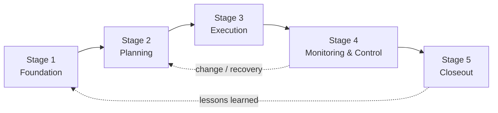
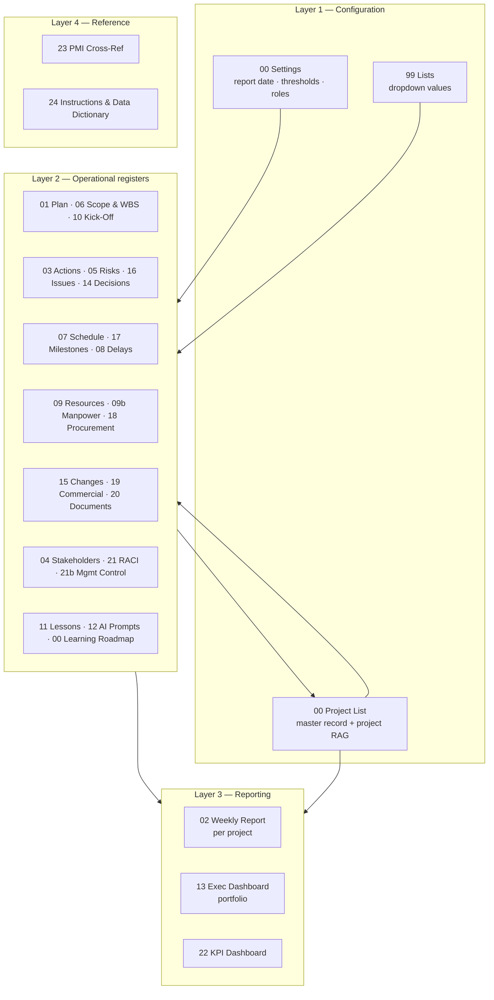
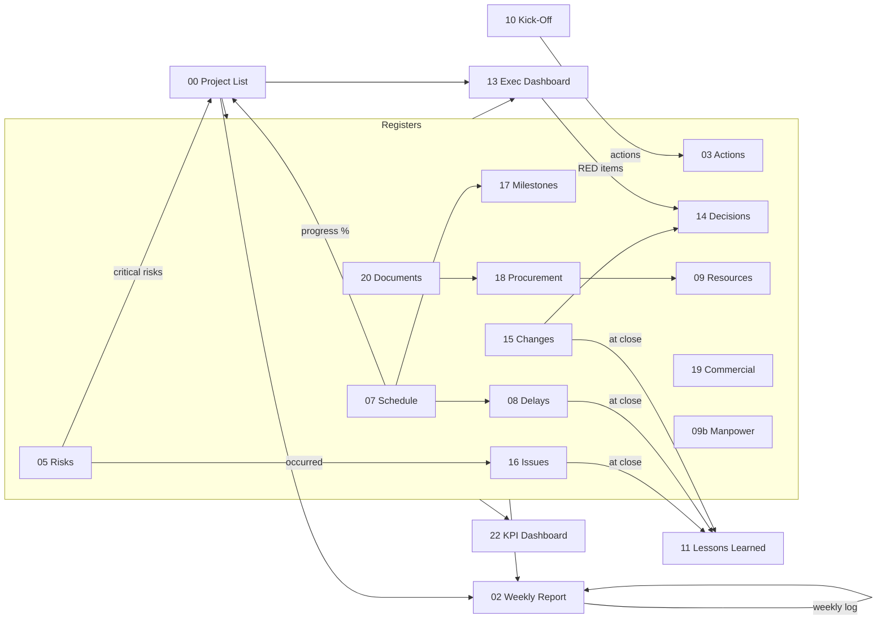

# Project Management Learning Roadmap & Project Control System

**For construction, real estate development, engineering and project-based companies in Oman and the GCC**

Companion workbook: `PM_Project_Control_Workbook.xlsx` (30 sheets, built by `build.py`).

---

## Executive summary

You learn project management here by running your own projects through it. Each of the {{LESSON_COUNT}} lessons ends with an exercise that puts a real entry into the workbook, so by the time someone finishes the roadmap, your company has a working project control system full of its own data. Nothing is left as theory on a shelf.

The workbook covers the 12 modules you asked for, plus the 12 control sheets that sit around them: the executive dashboard, decision log, change/variation register, issue register, milestones, procurement, commercial, document register, RACI, KPI dashboard, PMI cross-reference and instructions. Every register feeds the weekly report and the dashboards automatically. The PM writes the story; the formulas supply the numbers.

**What you can rely on**

- Every RAG status comes from a written threshold in `00 Settings`. You can see the rule, and you can change it only in one place.
- There's no invented project data. The single sample project is marked **SAMPLE DATA — REPLACE WITH ACTUAL PROJECT INFORMATION** on every row.
- The PMI references are current. As of September 2026 that means the *PMBOK® Guide – Eighth Edition* (released November 2025) and the new PMP® exam content outline (launched July 2026). The mapping between the two is my own analysis, and I've labelled it that way. PMI doesn't prescribe these templates.

---

## Assumptions

| # | Assumption | Why it matters | Change it in |
|---|---|---|---|
| 1 | Your company is usually the **contractor** delivering the works (main contractor or subcontractor), sometimes the developer. | Changes the perspective of the RACI, delay responsibility and payment tracking. | `21 RACI Matrix`, `00 Settings` roles |
| 2 | The work week runs Sunday to Thursday, and the reporting week ends on **Thursday**. | Weekly report and manpower week-ending dates. | `00 Settings` → `WeekEnding` |
| 3 | Currency is **OMR**, shown to 3 decimals. | All money columns. | Number formats |
| 4 | Contract notice period defaults to **28 days** and document review to **14 days**. | These are placeholder defaults, not legal advice. Each contract's own clauses win. | `00 Settings` |
| 5 | Planned % is **straight-line** between planned start and finish unless you enter the P6/MS Project figure. | A simplification. S-curves are more accurate. | `00 Project List` → override columns |
| 6 | RAG thresholds are **company defaults** (e.g. progress variance: GREEN ≥ −5%, RED < −10%). | They need calibrating to your risk appetite. | `00 Settings` |

---

## PMI framework used

| Source | What is used | Status |
|---|---|---|
| *PMBOK® Guide – Eighth Edition* (PMI, November 2025) | 6 principles, 7 performance domains, 5 focus areas | Verified via public summaries, September 2026 |
| PMP® Examination Content Outline (new exam, July 2026) | Domains: People 33%, Process 41%, Business Environment 26% | Verified from PMI's new-exam page, September 2026 |

- **Principles:** Adopt a Holistic View · Focus on Value · Embed Quality · Be an Accountable Leader · Integrate Sustainability · Build an Empowered Culture
- **Performance domains:** Governance · Scope · Schedule · Finance · Stakeholders · Resources · Risk
- **Focus areas:** Initiating · Planning · Executing · Monitoring and Controlling · Closing (40 processes. I haven't reproduced the individual process names because I couldn't verify them from a primary source.)

> **Important:** PMI doesn't require these templates, IDs, thresholds or RAG rules. They're company conventions built to support PMI principles. Contract notice periods, payment terms and delay entitlement come from **your contract and Omani law**, never from PMI.

---

## A. Complete course roadmap

The course has five stages and {{LESSON_COUNT}} lessons. At about 15 minutes of study a day plus the exercise done on a live project, a PM can complete it in roughly 10 to 12 weeks.

| Stage | Lessons | Modules / sheets used | Suggested timing | Outcome for the company |
|---|---|---|---|---|
| **1. Project Foundation** | L1.1 Charter · L1.2 Scope · L1.3 Stakeholders · L1.4 Kick-off | 1, 4, 6, 10 | Weeks 1–2 | Every live project is defined, scoped and kicked off the same way |
| **2. Project Planning** | L2.1 WBS · L2.2 Schedule · L2.3 Resources · L2.4 Risk · L2.5 Procurement · L2.6 Budget · L2.7 Integrated plan | 1, 5, 6, 7, 9, 17, 18 | Weeks 3–5 | Baselines exist for scope, time, cost, risk and resources |
| **3. Project Execution** | L3.1 Actions · L3.2 Communication · L3.3 Subcontractor coordination · L3.4 Resource monitoring · L3.5 AI tools | 3, 9, 12, 20, 21 | Weeks 6–7 | Meetings produce owned actions; the team uses AI safely |
| **4. Monitoring & Control** | L4.1 Weekly reporting · L4.2 Schedule control · L4.3 Risk monitoring · L4.4 Issues · L4.5 Commercial · L4.6 Delay analysis · L4.7 Change control | 2, 5, 7, 8, 13–17, 19, 22 | Weeks 8–10 | Weekly reports and dashboards that management trusts |
| **5. Project Closeout** | L5.1 Completion · L5.2 Outstanding actions · L5.3 Handover · L5.4 Lessons learned · L5.5 Performance review | 11, 17, 20, 22 | Weeks 11–12 | Projects close cleanly and the lessons reach the next project |

Track progress on the `00 Learning Roadmap` sheet. It shows completion % and flags overdue lessons.

---

## B. Module-by-module syllabus

### Module 1 — Project Plan (`01 Project Plan`)

**What it is.** The Project Management Plan is the single approved document that says how the project will be delivered, monitored and closed. It pulls 18 components together: objectives, business justification, deliverables, phases, scope, milestones, activities, dependencies, schedule, budget, resources, risks, stakeholders, communication, procurement, quality, monitoring and closure.

**Why you need it.** It's the baseline you measure against, the reference point for change control, and the evidence that management approved the approach. Without one, every disagreement turns into an opinion.

**Who does what.**

- **Prepares:** the Project Manager
- **Reviews:** the QS (commercial), Site Engineer (method and resources) and Procurement (long-lead items)
- **Approves:** the General Manager, or the sponsor

**When it's updated:** at award, whenever an approved change affects scope, time or cost, at re-baseline, at phase gates, and at least quarterly. Every update gets logged in the version table.

**What management should look at:**

- Are the objectives measurable?
- Is the margin still valid?
- Is contingency proportionate to the risks?
- Are the long-lead items ordered?
- Are payment milestones aligned with cash needs?
- Are the exclusions agreed with the client?

(These questions also appear in the *Management Review Focus* column.)

**Template:** 18 components, each with *what to define*, *linked sheet*, owner, status, planned and actual dates, plus a version-control table.

### Module 2 — Weekly Project Status Report (`02 Weekly Report`)

Select the project and the sheet fills in the project name, reporting week, overall and component RAG (schedule, budget, quality, HSE), planned/actual/variance %, CPI and completion forecast. It also pulls in next week's activities, critical milestones, delayed activities with delay days, root cause and recovery action, the commercial position (invoiced, certified, received, outstanding, overdue, variations, claims), manpower, equipment and material shortfalls, the top 5 risks and issues, and the decisions management needs to make.

The PM writes three things by hand: the **executive summary**, the **overall status narrative** and the list of **completed activities**.

**Executive summary formula (five lines, for the GM/CEO):**

1. Status: RAG plus one sentence
2. Key achievement this week
3. Main concern, with the numbers
4. Recovery action, with owner and date
5. Decision needed, from whom and by when

> *Example:* "AMBER — 4% behind plan. Partitions Level 1 complete. Ceiling boards arrive 6 days after the required date. Recovery: resequence Zone C, owner Site Engineer, from Sunday. Decision: approve extra crew (OMR 4,200) by Tuesday."

**The one rule that protects credibility:** the RAG must match the numbers. A GREEN report with RED figures (a "watermelon" report) destroys management's trust in the whole system.

### Module 3 — Meeting Action Tracker (`03 Meeting Actions`)

The tracker has every field you listed. Status is entered as Open, In Progress, Pending or Closed. **Current Status** is calculated, and turns to **Overdue** automatically once the target date has passed. *Days Outstanding*, *Days Overdue* and *Escalation Required* are also automatic. Escalation fires when an action is overdue by more than `EscDays` (default 7), or when a Critical action is overdue at all. Kick-off actions show up on `10 Kick-Off` automatically.

### Module 4 — Stakeholder Management (`04 Stakeholders`)

**Power/Interest method.** Score Power and Interest from 1 to 5. A score at or above `PIHigh` (default 3) counts as "high".

| | Low interest | High interest |
|---|---|---|
| **High power** | **Keep Satisfied** — consult in their area, brief them concisely, avoid surprises | **Manage Closely** — engage personally, involve them in key decisions |
| **Low power** | **Monitor** — general communication only | **Keep Informed** — regular updates; useful as an early-warning network |

Priority is the sum of Power, Interest, Influence and Impact: 16 or more is Critical, 12 or more High, 8 or more Medium. The engagement gap is the distance from current to desired engagement on the scale Unaware → Resistant → Neutral → Supportive → Leading. In Oman, remember the stakeholders who rarely appear on a client organogram: municipality and Civil Defence inspectors, the building or mall management, landlords, utility providers, neighbouring tenants and, on operator sites, the client's HSE and ICV teams.

### Module 5 — Risk Register (`05 Risk Register`)

Risk Score = Probability × Impact (each 1–5). The rating is automatic: **Low** below 5, **Medium** from 5, **High** from 10, **Critical** from 15. You can change the bands in `00 Settings`. Residual score and rating are calculated the same way. Risks not reviewed within `RiskReviewDays` (30) get flagged.

| Term | Meaning | Example | Where it lives |
|---|---|---|---|
| **Risk** | An uncertain future event that would affect objectives if it happened | Imported boards *may* arrive late | Risk Register |
| **Issue** | Something that has already happened and is affecting the project now | Boards *have* arrived late | Issue Register |
| **Assumption** | Something believed true for planning, not yet proven | Client will give access to Level 2 by 1 March | Scope statement; becomes a risk if doubtful |
| **Constraint** | A fixed limit you must work within | Night work only; handover date fixed; budget cap | Scope statement |

### Module 6 — Scope Management (`06 Scope & WBS`)

The scope statement covers 15 elements, from purpose through to approvals required. Below it sits the WBS (work package ID, owner, dates, deliverable, acceptance criteria, status). Duplicate WBS IDs are highlighted.

**How to control scope creep:**

1. Get the scope statement **and its exclusions** approved before work starts.
2. No instruction, no change. Every request goes into `15 Change Register`, even small or "free" ones.
3. Price the time and cost impact before doing the work. If work has to start before approval, record the GM's decision in `14 Decision Log`. The *Work Proceeded Before Approval* flag keeps it visible.
4. Confirm verbal instructions in writing within an agreed time.
5. Review pending changes weekly. Ageing turns AMBER at 30 days and RED at 60.
6. After approval, update the scope, schedule, budget and plan version.

### Module 7 — Project Schedule Summary (`07 Schedule`)

The schedule register has every field you listed, plus a forecast finish and an optional weight. The formulas work out duration, baseline progress % at the report date, variance, delay days, an **OVERDUE / LATE START** flag and a status (Completed, Overdue, Late Start, Not Started, Behind Schedule, In Progress).

| Term | Plain meaning |
|---|---|
| **Baseline** | The approved plan dates, frozen. You measure against them and never overwrite them. |
| **Critical path** | The longest chain of dependent activities. Any delay on it delays completion. |
| **Float** | How far an activity can slip without delaying completion (total float) or the next activity (free float). |
| **Milestone** | A zero-duration event marking a key achievement: contractual, payment, authority approval or handover. |
| **Dependency** | A logic link. FS = finish-to-start (the most common), SS = start-to-start, FF = finish-to-finish, SF = start-to-finish. |
| **Schedule variance** | Here, the progress version: actual % − planned %. Negative means behind. (The earned-value version is EV − PV.) |
| **Look-ahead schedule** | A 2–3 week detailed extract used to coordinate site work and subcontractors. |
| **Recovery schedule** | A revised plan showing how lost time will be recovered, with resources, cost and approval. |

### Module 8 — Delay Analysis (`08 Delay Register`)

The delay register uses 10 categories: client, contractor, consultant, authority, supplier, design, material, manpower, weather/external and unforeseen conditions. Contractual responsibility is chosen from a list: Employer/Client Risk, Contractor Risk, Shared/Concurrent, Neutral Event or **Under Assessment**.

**How to document delays objectively, without pinning blame you can't support:**

1. **Facts first.** Record what happened, on what date, and the document reference (letter, transmittal, minutes, site diary, photo).
2. **Separate the cause from the responsibility.** Record the category (what kind of delay) straight away. Leave *contractual responsibility* as "Under Assessment" until the QS or contracts lead has checked the clause.
3. **Record your own delays too.** A register that only lists client delays has no credibility in an EOT negotiation.
4. **State the critical-path impact.** Yes, No or TBD, backed by schedule evidence.
5. **Watch the notice period.** The sheet warns *NOTICE DUE SOON / NOTICE OVERDUE* against the default period. The contract clause always governs.
6. **Use neutral language.** Write "Drawings received 12 days after the review period (T-045/C-019)", not "Consultant failed again".
7. For claims above an agreed value, get professional delay analysis and legal advice.

### Module 9 — Resource Plan (`09 Resource Plan`, `09b Manpower`)

The resource plan covers human resources, subcontractors, equipment, materials and specialists: required vs available, shortage, dates, cost, utilisation % (required ÷ available) and status (SHORTAGE, LATE AVAILABILITY or OK). The manpower sheet tracks each trade weekly: planned, actual, variance, required, a productivity index and a RAG. In Oman, allow for visa and mobilisation lead times for new labour and for the summer midday outdoor-work restriction. Check the current Ministry of Labour decision for exact dates and hours.

### Module 10 — Project Kick-Off (`10 Kick-Off`)

The kick-off template has the 24-item agenda you specified, with key points, suggested durations (155 minutes in total), presenters and a covered/not-covered tracker. Below it is a **live kick-off action register** that pulls every action logged in `03 Meeting Actions` with *Meeting Type = Kick-Off* for the selected project. Hold an **internal** kick-off first, then the **client** kick-off.

### Module 11 — Lessons Learned (`11 Lessons Learned`)

The lessons register includes the 13 categories you specified. A lesson only counts as learned when it changes a template, checklist, SOP or threshold. Capture lessons at every phase end, and describe systems, not individuals.

### Module 12 — AI Prompt / Command Library (`12 AI Prompt Library`)

There are 18 prompts, each with purpose, required input, prompt text, expected output, when to use and responsible role. Every prompt tells the AI not to invent facts and to list the information it's missing. Three rules apply to all of them:

- Use company-approved tools for confidential data.
- Check every number and clause against the source.
- A named person reviews the output before it's issued.

The full prompts are in the appendix.

### B2. Lesson cards (12 elements each)

{{LESSON_CARDS}}

---

## C. Excel workbook architecture

**Design rules applied**

- Every operational area is a proper **Excel Table** (31 in total) with filters and frozen headers. There are no merged cells inside tables, so everything is pivot-ready.
- **Unique IDs** are pre-filled (`RSK-001`, `ACT-001`…) and duplicates turn red.
- **Dropdowns** cover every coded field (status, priority, category, score, project). The lists live in `99 Lists`.
- Input cells are **white and unlocked**. Formula cells are **grey and locked**, and the sheets are protected without a password so filters and formatting still work.
- Grey-headed **helper columns** on the right do the sorting for the "top 5" lists without newer Excel functions. That keeps the file working in Excel 2013 and later, Excel 365 and LibreOffice.
- Every register has a responsible person, planned and actual dates, status, priority, comments and a last-updated date.
- `00 Settings → ReportDate` defaults to `=TODAY()`. Overwrite it with a fixed date to freeze a reporting period.

---

## D. Sheet names

{{SHEET_NAMES}}

---

## E. Columns required for every sheet

Columns marked *(auto)* are formulas. Everything else is input.

{{SHEET_COLUMNS}}

The complete data dictionary (every column, input or auto, allowed values and first-row formula) is on sheet `24 Instructions`.

---

## F. Formula requirements

**General rules**

1. Every formula returns `""` on an empty row, so blank rows never show errors or zeros.
2. "Today" is always the named cell `ReportDate`, never a hard-coded date.
3. Every threshold is a named cell in `00 Settings` (e.g. `RiskCrit`, `EscDays`). No magic numbers inside formulas.
4. Overdue logic: *not closed* **and** *target date < ReportDate*.
5. Ageing: `ReportDate − reference date` (meeting date, submission date, date raised).
6. Variance: `actual − planned`. Negative is bad for progress and positive is bad for dates.
7. Money: OMR, 3 decimals. Division by zero is guarded with `IFERROR`/`N()`.
8. Top-N lists use `LARGE`/`SMALL` on a helper key (value + `ROW()/100000` to break ties) with `INDEX/MATCH`. No dynamic-array functions.

**Key formulas as built** (row 7, the first data row):

{{FORMULAS}}

---

## G. KPI definitions

KPI thresholds can be edited on `22 KPI Dashboard`. "Higher" means higher is better.

{{KPIS}}

---

## H. RAG rules

**Meaning**

| RAG | Meaning | Required response |
|---|---|---|
| 🟢 **GREEN** | On track: within all thresholds | None beyond normal reporting |
| 🟠 **AMBER** | Attention required: at least one threshold breached | PM recovery action with owner and date; GM informed in the weekly report |
| 🔴 **RED** | Critical: management intervention required | GM decision or support this week, recorded in `14 Decision Log` |
| ⚪ **NO DATA** | Required input missing | Treated as a reporting failure, **never** as GREEN |

**Thresholds (named cells in `00 Settings`, company defaults)**

{{SETTINGS}}

**Project RAG logic (`00 Project List`)**

| Component | GREEN | AMBER | RED |
|---|---|---|---|
| Schedule (worst of two tests) | Variance ≥ −5% **and** forecast completion ≤ planned | Variance −5% to −10% **or** slip 1–30 days | Variance < −10% **or** slip > 30 days |
| Budget (worst of two tests) | CPI ≥ 0.95 **and** FAC ≤ budget | CPI 0.90–0.95 **or** FAC ≤ budget + 5% | CPI < 0.90 **or** FAC > budget + 5% |
| Quality | No overdue NCRs and open NCRs ≤ 3 | Any overdue NCR or open NCRs > 3 | Overdue NCRs ≥ 3 |
| HSE | No recordable incidents and no overdue observations | Any overdue HSE observation | Any recordable/LTI incident in the period |
| Risk | No open Critical risks | 1–2 open Critical risks | ≥ 3 open Critical risks |
| **Overall** | **Worst of the five components above** | | |

The dashboard tiles show their rule next to each value on `13 Exec Dashboard`. For example: overdue actions are GREEN at 0, AMBER at 1–4 and RED at 5 or more. Payments turn RED if any amount is more than 60 days overdue. Decisions turn RED if any is past its required-by date.

---

## I. Workflow between sheets

**The weekly control cycle**

| Day | Activity | Sheets | Who |
|---|---|---|---|
| Sunday | Site look-ahead meeting; log actions | 07, 03 | Site Engineer |
| Mon–Tue | Update progress, delays, procurement, documents, manpower | 07, 08, 18, 20, 09b | Site Engineer / Planner / Procurement |
| Tuesday | Update commercial, changes, risks, issues | 19, 15, 05, 16 | QS / PM |
| Wednesday | PM reviews dashboards; drafts weekly report | 02, 13 | PM |
| Thursday | Issue weekly report; record in log | 02 | PM → GM |
| Thursday | Management review: RED items, decisions, escalations | 13, 22, 14 | GM + PMs |

---

## J. Management approval points

**Approval gates**

| Gate | What is approved | Approver | Evidence in workbook |
|---|---|---|---|
| G0 — Award / go | Project definition, margin, PM authority | GM | `00 Project List`, `01 Project Plan` §1–2 |
| G1 — Baseline | Scope, WBS, schedule, budget, risk register | GM | `01 Project Plan` status = Approved; version 1.0 |
| G2 — Kick-off | Roles, communication, processes | GM (internal), client (external) | `10 Kick-Off`, minutes |
| G3 — Change | Variations above PM authority; work before approval | GM, then client | `15 Change Register`, `14 Decision Log` |
| G4 — Recovery | Recovery plans with cost | GM | `14 Decision Log`, `07 Schedule` recovery action |
| G5 — Notices / EOT | Delay notices and EOT submissions | GM | `08 Delay Register` |
| G6 — Completion | Completion certificate request, handover | GM | `17 Milestones`, `20 Document Register` |
| G7 — Close | Final account, lessons learned, performance review | GM | `11 Lessons Learned`, `22 KPI Dashboard` |

**Management control matrix (who prepares, reviews, approves; how often; escalation; reporting)**

{{GOVERNANCE}}

**RACI (default. Edit the role names in `00 Settings` and the letters on `21 RACI Matrix`)**

{{RACI}}

---

## K. 30-day implementation roadmap

The principle is to start small, prove it on one project, then scale. Don't open all 30 sheets on day one.

| Week | Focus | Actions | Owner | Output / KPI |
|---|---|---|---|---|
| **Week 1 (Days 1–7): Set up** | Configure and pick a pilot | Day 1: GM names a system owner (PMO/senior PM) and **one pilot project**. Day 2: set company name, roles and review thresholds in `00 Settings` (GM approves). Day 3: register all active projects in `00 Project List`; delete the sample row. Days 4–5: 1-hour team briefing using `24 Instructions`. Days 6–7: load the pilot's schedule (top 30–50 activities) and milestones. | GM, system owner, pilot PM | Settings approved; all projects listed; pilot baseline loaded |
| **Week 2 (Days 8–14): Control basics** | Actions, risks, issues on the pilot | Log the last 4 weeks of meeting actions (`03`). 1-hour risk workshop → 10–15 risks (`05`). Log current issues (`16`) and pending decisions (`14`). Issue the **first weekly report** (`02`) on Day 14. | Pilot PM, Site Engineer, QS | First weekly report issued; overdue actions visible |
| **Week 3 (Days 15–21): Commercial & supply** | Money and materials | Load invoices and payments (`19`) and reconcile with Finance. Load variations and claims (`15`). Load long-lead procurement (`18`) and submittals (`20`). Start weekly manpower (`09b`). GM reviews `13 Exec Dashboard` for the first time. | QS, Finance, Procurement, Site Engineer | Commercial tracker reconciled; dashboard reviewed in the management meeting |
| **Week 4 (Days 22–30): Scale & embed** | Roll out and lock in | Roll out to 1–2 more projects. Add stakeholders (`04`), RACI (`21`) and scope/WBS (`06`) for new projects. Record the first lessons (`11`). Day 28: 30-day review — what to simplify, which thresholds to recalibrate. Day 30: GM confirms the weekly cycle as company procedure; PMs start roadmap Stage 1. | System owner, GM, all PMs | 3 projects live; weekly cycle adopted; learning roadmap started |

**Adoption KPIs at day 30:** weekly report issued on time for 100% of live projects; no project showing NO DATA on the dashboard; overdue-action ratio falling week on week; at least one management decision recorded from a RED item.

**How to avoid overwhelming the team**

- Start with only 6 sheets: `00 Project List`, `07 Schedule`, `03 Meeting Actions`, `05 Risk Register`, `16 Issue Register`, `02 Weekly Report`.
- One owner per register. Updates happen during the week, not all on Thursday night.
- Hide the columns you don't need yet rather than deleting them.
- Use `12 AI Prompt Library` to turn rough notes into minutes and reports.

---

## Risks and controls for the system itself

| Risk | Control |
|---|---|
| Garbage in, garbage out: registers not updated | One owner per register; the NO DATA status is visible; weekly cycle deadlines |
| RAG gaming (watermelon reporting) | RAG is formula-driven from thresholds; PMs can't type a RAG on the dashboard |
| Formulas broken by edits | Formula cells locked; instructions say hide, don't delete |
| Thresholds set too loose or too tight | Quarterly recalibration by the GM; defaults documented |
| Contract terms differ from defaults | Notice/review/payment periods flagged as defaults to be confirmed per contract |
| Confidential data in public AI tools | Prompt library rules; company-approved tools only |
| Single spreadsheet doesn't scale beyond ~20 projects or many simultaneous users | Keep it on SharePoint/OneDrive with version history; move to a PM platform once the process is stable |

---

## Validation still required

1. **Contract clauses.** Notice periods, payment terms, review periods and LD/EOT provisions for each contract. The defaults are placeholders.
2. **Omani regulatory items** mentioned as examples: the summer midday work restriction, Omanisation and ICV requirements, and Civil Defence/municipality approval routes. Confirm current rules with the relevant authority or client.
3. **RAG thresholds.** Calibrate them to your company's risk appetite and historical performance.
4. **PMBOK 8 detail.** I checked the principle, domain and focus-area names against public summaries. The individual process names aren't reproduced. Check against your own copy of the Guide.
5. **The workbook in your Excel version.** It was built and recalculated with no formula errors (16,000+ formulas) and uses only Excel 2010+ functions (`SUMIFS`, `COUNTIFS`, `AVERAGEIFS`, `INDEX/MATCH`, `AGGREGATE`). Open it once in your own Excel and confirm the dashboard matches the sample values before you delete the sample row.

---

## Appendix — AI Prompt Library (full text)

{{PROMPTS}}

---

*PMBOK® and PMP® are registered marks of the Project Management Institute, Inc. This material is independent and not endorsed by PMI.*
